# Лабораторная работа 1. Установка GNS3 и базовая настройка

## Цель работы

1. Ознакомиться с виртуальным лабораторным стендом GNS3.
2. Установить и настроить GNS3 на рабочей станции.
3. Подготовить рабочую среду: образ SONiC, тестовые узлы, тестовый проект.

## Оборудование и ПО

| Компонент | Значение |
|---|---|
| ОС | Windows 11 Home 10.0.26200 (x64) |
| Процессор | Intel Core i3-12100F, 4 ядра / 8 потоков, VT-x включён в BIOS |
| ОЗУ | 16 ГБ |
| Hyper-V | выключен (нужно, чтобы VirtualBox передавал VT-x внутрь GNS3 VM) |
| Гипервизор для GNS3 VM | Oracle VirtualBox 7.2.10 |
| GNS3 | 2.2.61 (последний стабильный релиз ветки 2.2, 30.07.2026) |
| GNS3 VM | GNS3.VM.VirtualBox.2.2.61 |
| SONiC | sonic-vs.img, ветка 202511, с официального сборочного сервера SONiC |

Почему GNS3 VM, а не локальный сервер: QEMU на Windows работает без KVM, и SONiC в нём почти не запускается. В GNS3 VM (Linux) есть KVM, и QEMU-узлы работают с аппаратным ускорением за счёт вложенной виртуализации VirtualBox.

## Ход работы

### 1. Установка GNS3

- Скачан `GNS3-2.2.61-all-in-one.exe` с [GitHub GNS3](https://github.com/GNS3/gns3-gui/releases/tag/v2.2.61).
- Проверена целостность: SHA256 `32956fb7…c809f765` совпадает с опубликованной, подпись Authenticode валидна (SolarWinds Worldwide, LLC).
- Тип установки Custom: GNS3 Desktop и Tools. Пункт «GNS3 VM» в установщике не отмечался, потому что он скачивает VM под VMware, а используется версия под VirtualBox, импортированная отдельно (см. п. 2).
- Установленные компоненты: GNS3 2.2.61, Npcap 1.78 (захват трафика и узел Cloud), Wireshark 4.6.7, Dynamips, VPCS, uBridge, cpulimit, QEMU 3.1.0 для локального сервера.

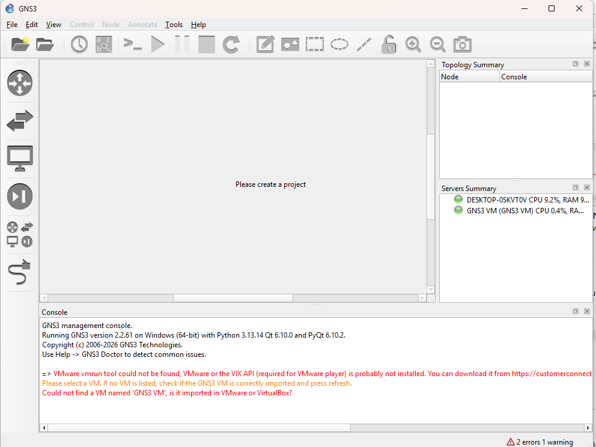

### 2. Настройка GNS3 и проверка работоспособности

**GNS3 VM в VirtualBox.**

- Скачан `GNS3.VM.VirtualBox.2.2.61.zip`, SHA256 `7d21999c…25469b5746` совпадает с `GNS3.VM.checksums.sha256` из релиза.
- OVA импортирована с 4 vCPU и 8 ГБ ОЗУ, после этого включена вложенная виртуализация:

```powershell
VBoxManage import "GNS3 VM.ova" --vsys 0 --cpus 4 --memory 8192
VBoxManage modifyvm "GNS3 VM" --nested-hw-virt on --nested-paging on `
  --nic1 hostonly --host-only-adapter1 "VirtualBox Host-Only Ethernet Adapter" --nic2 nat
```

- Адаптер 1 (Host-Only, 192.168.56.0/24) нужен для связи GUI с сервером в VM, адаптер 2 (NAT) даёт VM выход в интернет. На Host-Only сети работает DHCP VirtualBox, и VM получила адрес 192.168.56.101.
- Проверка через API сервера в VM: `GET /v2/version` → `2.2.61`, `GET /v2/compute/qemu/capabilities` → `kvm: x86_64, i386`. Значит, KVM внутри VM доступен и QEMU-узлы будут работать с аппаратным ускорением.

**Setup Wizard при первом запуске GNS3:** Server type «Run appliances in a virtual machine», локальный сервер `localhost:3080`, GNS3 VM на движке VirtualBox (VM name `GNS3 VM`, 4 vCPU, 8192 МБ). После этого в Servers Summary оба сервера отмечены зелёным: локальный `DESKTOP-0SKVT0V` и `GNS3 VM`.

Создан пустой проект `lab1`.

**Проверка Edit → Preferences:**

| Раздел | Значение |
|---|---|
| Dynamips | `C:\Program Files\GNS3\dynamips\dynamips.EXE`. Запуск `dynamips.exe --help` выводит `Cisco Router Simulation Platform (version 0.2.17-x86/Windows stable)`, то есть Dynamips рабочий |
| VirtualBox | `C:\Program Files\Oracle\VirtualBox\VBoxManage.exe` |
| GNS3 VM | Enable ✓, VirtualBox, `GNS3 VM`, порт 80, 4 vCPU / 8192 МБ. Позже память уменьшена до 6144 МБ и включён headless-режим, см. «Проблемы и их решение» |
| QEMU | Enable hardware acceleration (KVM/HAXM) ✓, Require hardware acceleration ✓ |

Сервер в GNS3 VM поддерживает типы узлов qemu, dynamips, docker, iou, vpcs, virtualbox, vmware, ethernet_switch, cloud, nat и другие (`GET /v2/compute/capabilities`).

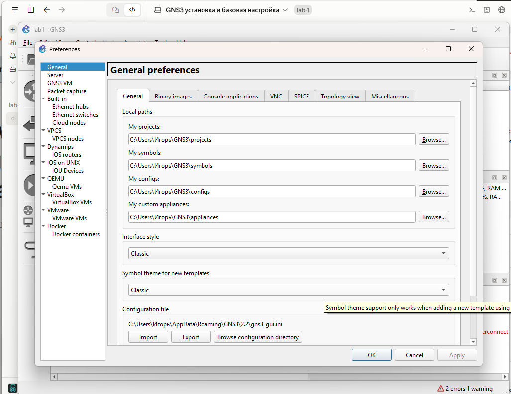
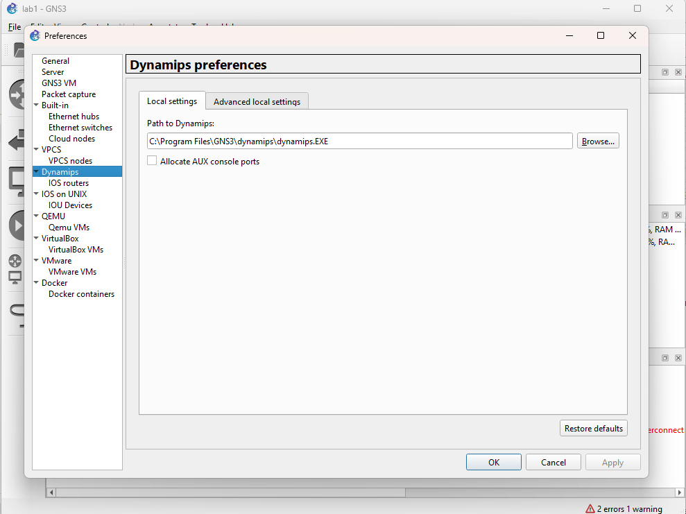
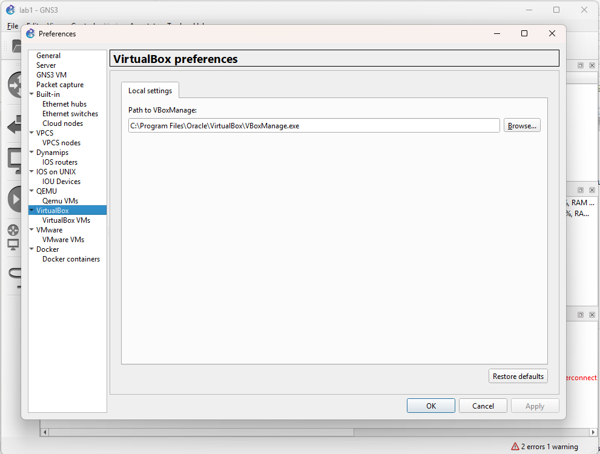
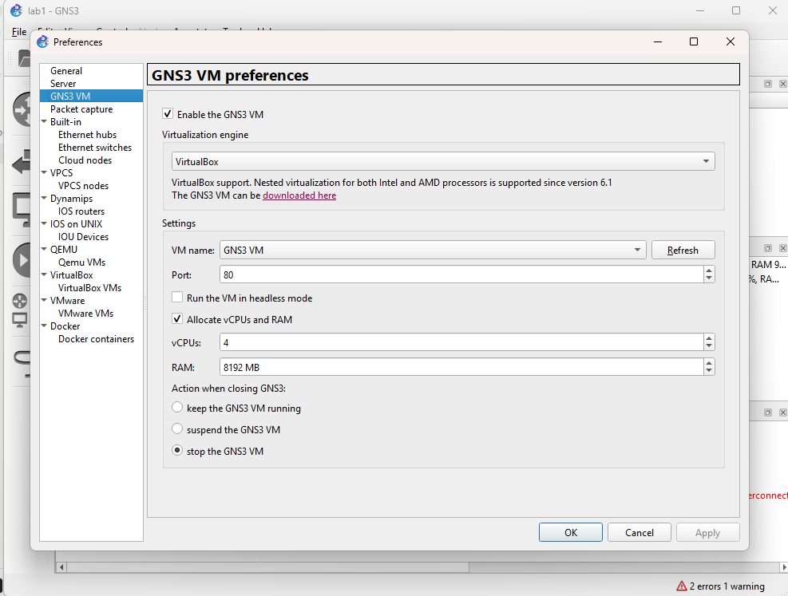
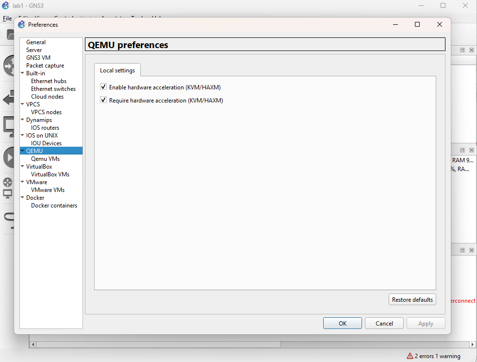

> Замечание: в системе заданы переменные `HTTP_PROXY`/`HTTPS_PROXY=127.0.0.1:10809` (VPN-клиент), а подсети 192.168.56.0/24 нет в `NO_PROXY`. Из-за этого первый запрос к API GNS3 VM через curl ушёл в прокси и вернул 503. С `--noproxy "*"` всё работает. GUI GNS3 эти переменные не использует.

### 3. Добавление образа SONiC

- Скачан `sonic-vs.img.gz` (ветка 202511) с `sonic-build.azurewebsites.net` и распакован. CRC gzip корректна, получился файл в формате qcow2 (сигнатура `QFI\xfb`) размером 6,0 ГБ, сохранён как `sonic-vs-202511.qcow2`.
- Образ загружен в GNS3 VM через API: `POST /v2/compute/qemu/images/sonic-vs-202511.qcow2`.

**QEMU template** (Edit → Preferences → QEMU → Qemu VMs → New → «Run this Qemu VM on the GNS3 VM»):

| Параметр | Значение | Зачем |
|---|---|---|
| Template name | `SONiC-VS-202511` | |
| Symbol / Category | `classic/multilayer_switch.svg` / Switches | SONiC — коммутатор L2/L3 |
| RAM / vCPUs | 4096 МБ / 2 | рекомендуемый объём для SONiC VS, с ним поднимаются все контейнеры |
| QEMU binary | `/bin/qemu-system-x86_64` (v10.2.1) в GNS3 VM, с KVM | |
| Boot priority / On close | HDD / Power off the VM | |
| Console type | telnet | серийная консоль SONiC (`ttyS0`) |
| HDA | `sonic-vs-202511.qcow2`, интерфейс virtio | |
| Adapters | 9, тип Intel Gigabit Ethernet (e1000) | eth0 для управления и 8 портов данных |
| First port name / Name format | `eth0` / `eth{port1}` | имена совпадают с интерфейсами Linux внутри SONiC VS |

Соответствие портов GNS3 и интерфейсов SONiC: `eth0` — management (`eth0` в SONiC), `eth1` → `Ethernet0`, `eth2` → `Ethernet4`, `eth3` → `Ethernet8` и далее с шагом 4. Так устроена схема портов HWSKU Force10-S6000, который SONiC VS использует по умолчанию.

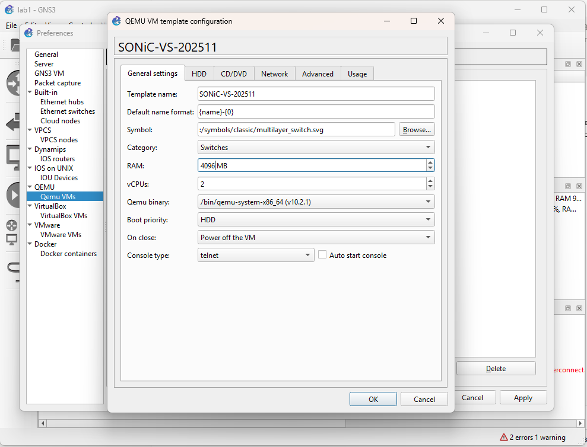
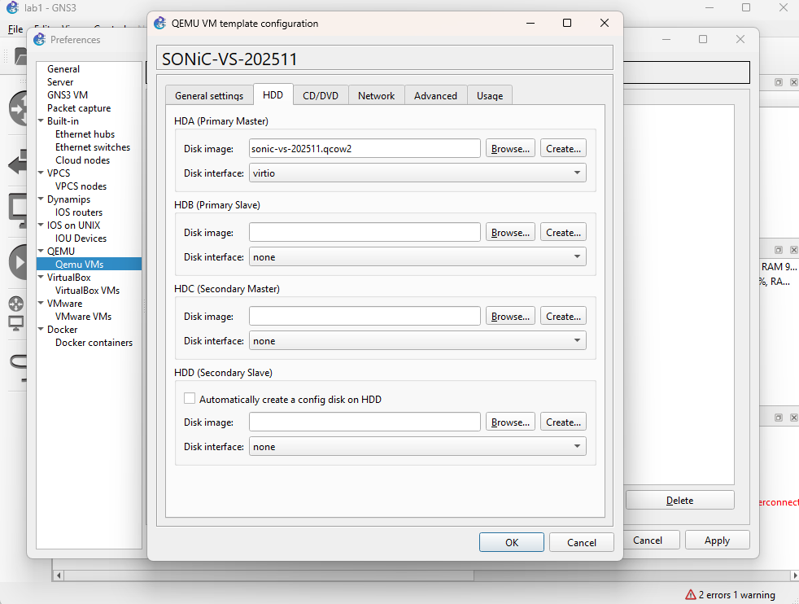
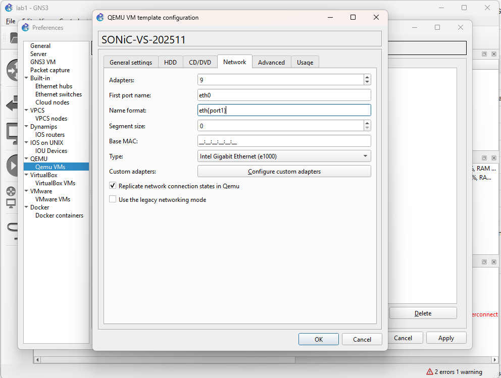

### 4. Тестовый проект

В проекте `lab1` собраны два сегмента, все узлы работают на GNS3 VM.

```
Сегмент А (L2):   PC1 ── Switch1 (Ethernet switch GNS3) ── PC2
                  10.0.0.1/24                             10.0.0.2/24

Сегмент Б (L3):   PC3 ──eth1/Ethernet0── SONiC-VS-202511-1 ──eth2/Ethernet4── PC4
                  192.168.10.10/24      192.168.10.1/24 | 192.168.20.1/24     192.168.20.10/24
                  gw 192.168.10.1                                              gw 192.168.20.1
```

**Сегмент А: VPCS ↔ коммутатор GNS3 ↔ VPCS.**

```
PC1> ip 10.0.0.1/24
PC2> ip 10.0.0.2/24
PC2> ping 10.0.0.1
84 bytes from 10.0.0.1 icmp_seq=1 ttl=64 time=0.190 ms
...
84 bytes from 10.0.0.1 icmp_seq=5 ttl=64 time=0.326 ms
```

Получено 5 ответов из 5, ttl=64: узлы в одном L2-домене, маршрутизации нет.

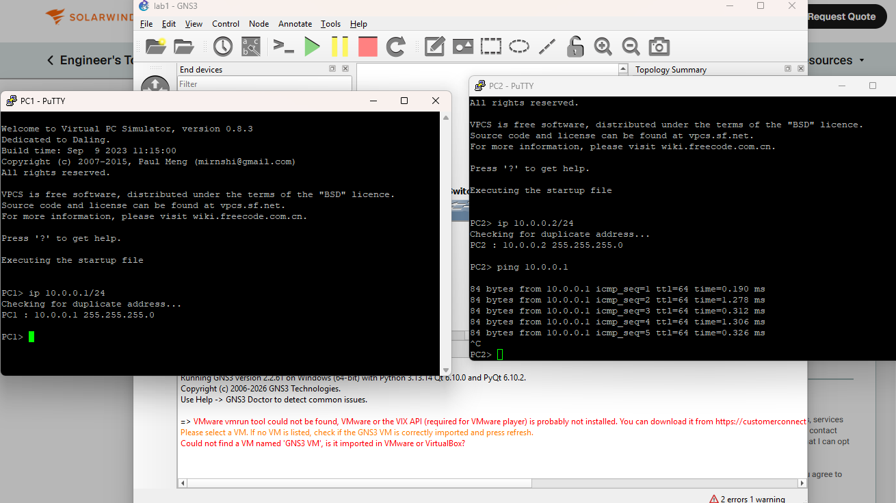

**Сегмент Б: маршрутизация через SONiC.**

После загрузки (около 5 минут до появления всех контейнеров) SONiC VS определяется как платформа `x86_64-kvm_x86_64-r0`, HwSKU `Force10-S6000`, ASIC `vs`. Запущены контейнеры `database`, `swss`, `syncd`, `gbsyncd`, `bgp`, `teamd`, `sysmgr`, `eventd`, `radv`, в CONFIG_DB 32 порта. Когда загрузка заканчивается, SONiC применяет стандартную T1-конфигурацию: на каждом порту адрес `10.0.0.x/31` и BGP-сосед `ARISTAxxT2`/`T0`. Сразу после входа в систему, пока загрузка не закончилась, `show ip interfaces` и `show interfaces status` выводят пустые таблицы.

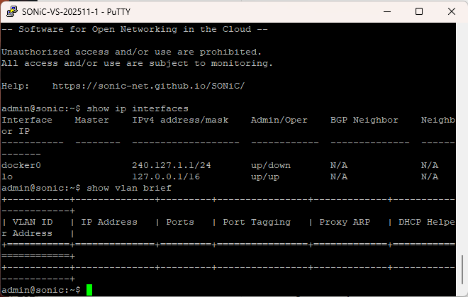
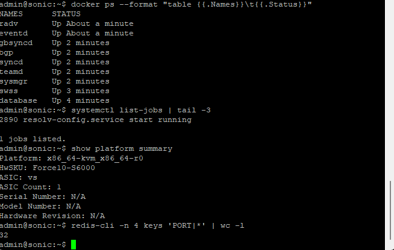

Настройка интерфейсов SONiC (адреса добавляются к T1-адресам как дополнительные):

```
sudo config interface ip add Ethernet0 192.168.10.1/24
sudo config interface ip add Ethernet4 192.168.20.1/24
sudo config interface startup Ethernet0
sudo config interface startup Ethernet4
sudo config save -y
```

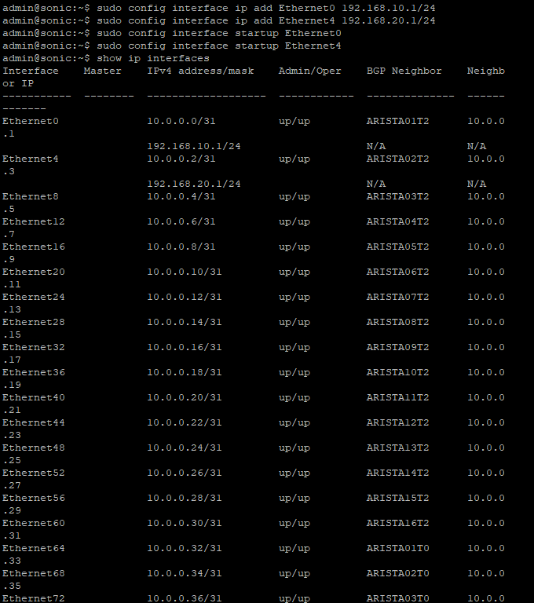

Проверка:

```
PC3> ip 192.168.10.10/24 192.168.10.1
VPCS> ip 192.168.20.10/24 192.168.20.1      # консоль PC4
VPCS> ping 192.168.10.10
84 bytes from 192.168.10.10 icmp_seq=1 ttl=63 time=9.120 ms
84 bytes from 192.168.10.10 icmp_seq=2 ttl=63 time=2.798 ms
84 bytes from 192.168.10.10 icmp_seq=3 ttl=63 time=2.557 ms
```

`ttl=63` (VPCS отправляет пакеты с TTL 64) показывает, что пакет прошёл ровно через один маршрутизатор, то есть через SONiC. Первый пакет медленнее остальных из-за ARP-разрешения.

```
admin@sonic:~$ show arp
Address        MacAddress         Iface      Vlan
-------------  -----------------  ---------  ------
192.168.10.10  00:50:79:66:68:02  Ethernet0  -
192.168.20.10  00:50:79:66:68:03  Ethernet4  -
```

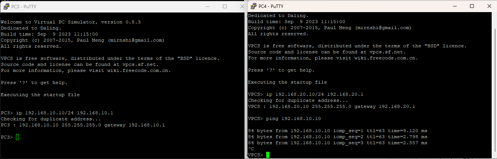
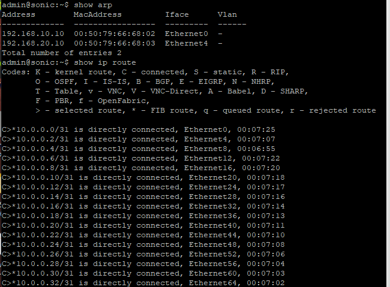

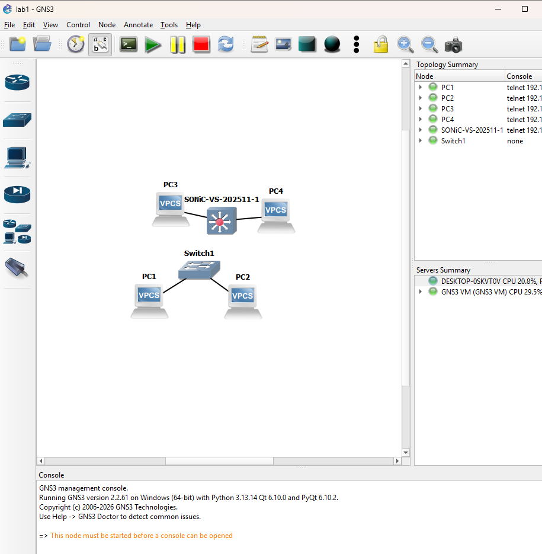

## Проблемы и их решение

1. **Падение GNS3 VM в VirtualBox при запуске SONiC.** Через несколько минут после старта узла SONiC GNS3 VM остановилась с ошибкой `Guru Meditation -2701 (VERR_VMM_RING0_ASSERTION)`. В `VBox.log` сработала проверка в `pgmPoolTracDerefGCPhys ... fIsNested=true`, в стеке вызовов `pgmR0BthEPTProtNestedTrap0eHandler`. Это ошибка VirtualBox 7.2 в коде теневых таблиц для вложенного EPT, который используется, когда KVM внутри GNS3 VM запускает свою гостевую систему. В changelog VirtualBox 7.2.11–7.2.20 исправлений вложенной виртуализации нет.
   Решение: не передавать гостю функцию EPT, тогда KVM внутри GNS3 VM использует теневые таблицы страниц.
   ```powershell
   VBoxManage setextradata "GNS3 VM" "VBoxInternal/CPUM/NestedVmxEpt" 0
   ```
   После этого SONiC загружается (дольше, чем с EPT) и работал без сбоев всё время тестирования. Память GNS3 VM уменьшена до 6144 МБ, чтобы на хосте с 16 ГБ оставался запас. Альтернативы: VMware Workstation Pro (рекомендуемый движок GNS3) или Docker-образ `docker-sonic-vs`, который не требует вложенной виртуализации.
2. **Сброс настроек GNS3 после перезапуска.** Первый запуск GNS3 произошёл из процесса стороннего приложения, установленного как пакет MSIX. Из-за виртуализации файловой системы MSIX настройки записались в `AppData\Local\Packages\<пакет>\LocalCache\Roaming\GNS3`, а не в `%APPDATA%\GNS3`. После обычного запуска GNS3 прочитал пустой `%APPDATA%` и сбросил настройки GNS3 VM. Решение: настройки GNS3 VM заданы заново, QEMU-шаблон SONiC пересоздан.
3. **Системный прокси.** См. замечание в п. 2: для обращения к API GNS3 VM нужен `curl --noproxy "*"`.

## Выводы

1. Установлен GNS3 2.2.61 со всеми компонентами (Dynamips, VPCS, uBridge, QEMU, Npcap, Wireshark). Для запуска тяжёлых образов используется GNS3 VM в VirtualBox с вложенной виртуализацией: на Windows QEMU без KVM для SONiC непригоден.
2. Проверена работа эмуляторов: Dynamips запускается, KVM внутри GNS3 VM доступен (`qemu capabilities: kvm x86_64`).
3. Подготовлен образ SONiC VS 202511 и QEMU-шаблон для него. Соответствие портов: `ethN` в GNS3 → `Ethernet(4·(N−1))` в SONiC.
4. Тестовый проект подтверждает работу сети: L2-связность через коммутатор GNS3 и L3-маршрутизацию через SONiC (ping PC4 → PC3 с ttl=63, ARP-записи на `Ethernet0`/`Ethernet4`).
5. Вложенная виртуализация в VirtualBox 7.2 нестабильна: потребовался обход через отключение вложенного EPT. Для следующих лабораторных с несколькими экземплярами SONiC стоит рассмотреть VMware Workstation Pro или Docker-вариант SONiC.
