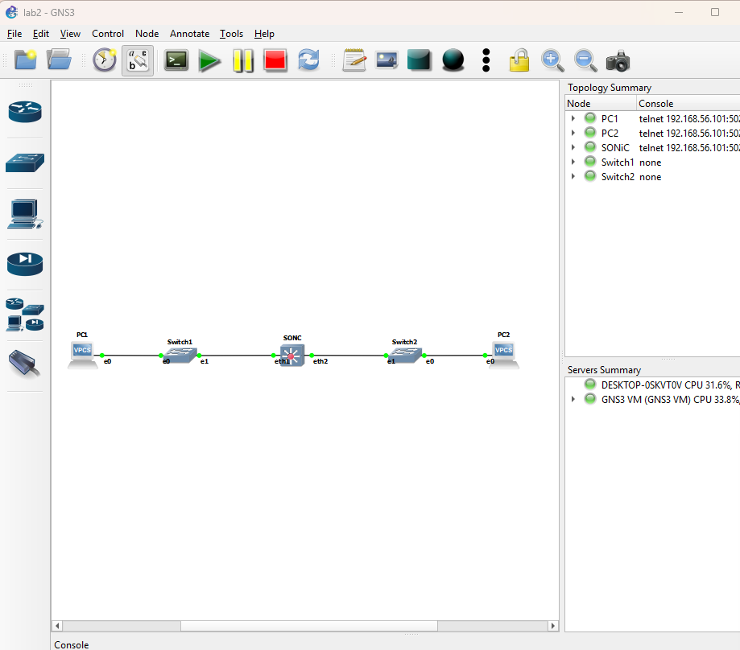
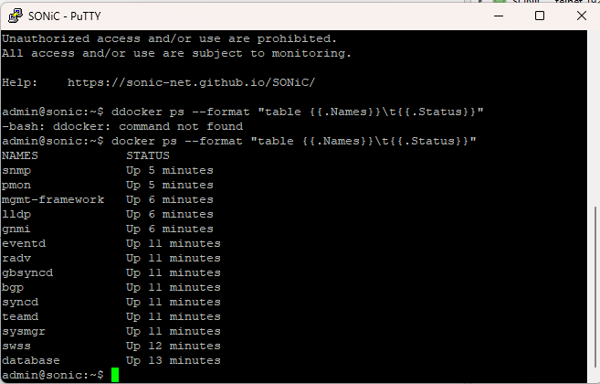
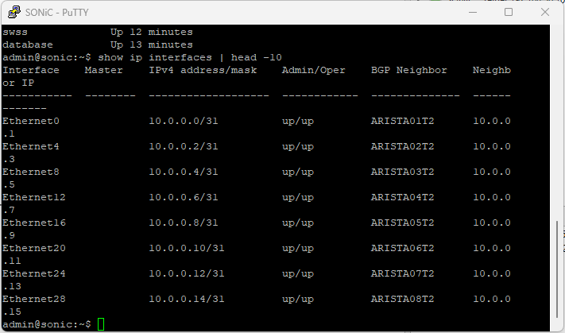
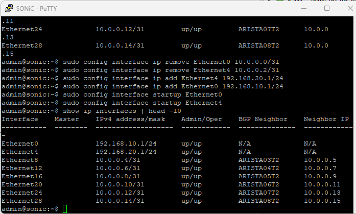
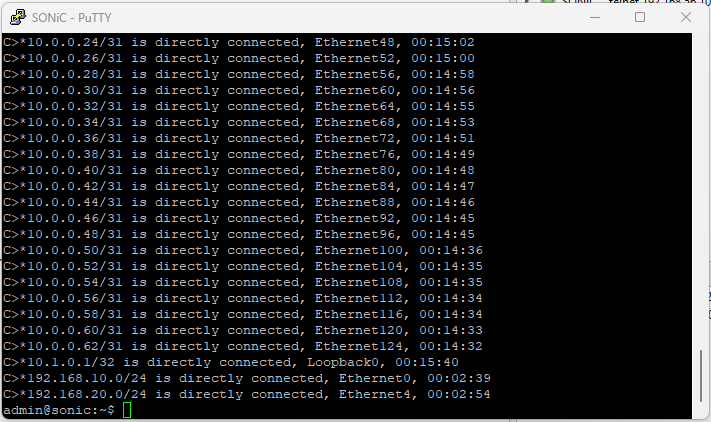
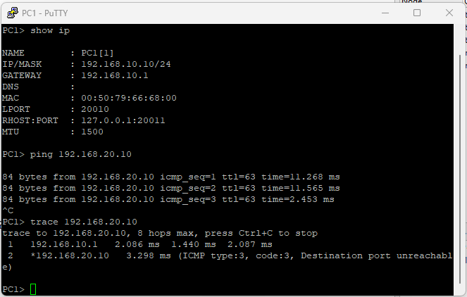
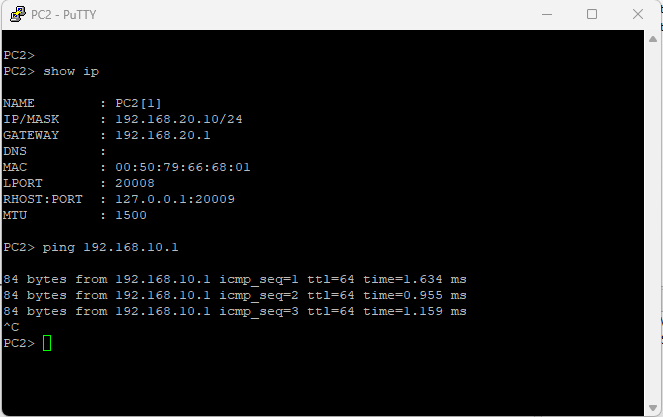
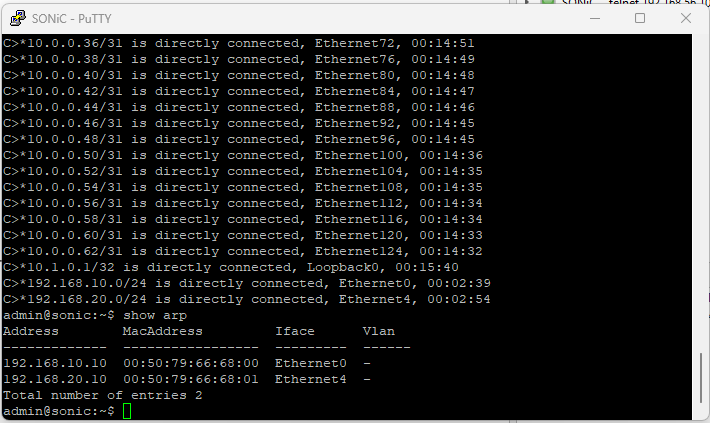

# Лабораторная работа 2. Настройка маршрутизатора SONiC в GNS3 и построение простой сети

Дисциплина «Виртуализация сетевых функций». Яковлев Игорь Сергеевич, группа К3420.

## ВВЕДЕНИЕ

Цель работы — освоить базовую конфигурацию маршрутизатора на основе сетевой операционной системы SONiC, построить в GNS3 тестовую сеть из маршрутизатора, двух коммутаторов и двух компьютеров и настроить маршрутизацию между двумя подсетями.

Для достижения цели решались следующие задачи:

- создать в GNS3 сеть из одного маршрутизатора SONiC, двух коммутаторов и двух хостов;
- настроить IP-адреса на интерфейсах SONiC и хостов;
- обеспечить связность между хостами через маршрутизатор и проверить её командами ping и trace.

Работа выполнена на стенде из лабораторной работы 1: GNS3 2.2.61, GNS3 VM в VirtualBox 7.2.10, образ SONiC VS ветки 202511 и QEMU-шаблон для него (4096 МБ, 2 vCPU, 9 адаптеров e1000). Хосты эмулируются программой VPCS 0.8.3, коммутаторы — встроенным узлом Ethernet switch GNS3.

## 1 ТОПОЛОГИЯ СЕТИ

### 1.1 Состав сети

В GNS3 создан проект lab2 из пяти узлов, все они работают на GNS3 VM (рисунок 1). Каждый хост подключён к своему коммутатору, а коммутаторы — к портам маршрутизатора SONiC. Соединения приведены в таблице 1.

**Таблица 1 – Соединения в топологии**

| Кабель | Узел А, порт | Узел Б, порт |
|---|---|---|
| 1 | PC1, e0 | Switch1, Ethernet0 |
| 2 | Switch1, Ethernet1 | SONiC, eth1 (Ethernet0) |
| 3 | SONiC, eth2 (Ethernet4) | Switch2, Ethernet1 |
| 4 | Switch2, Ethernet0 | PC2, e0 |

Узлы и соединения описаны в файле проекта `lab2.gns3`, подготовленном на основе описаний узлов из проекта лабораторной работы 1. Проект открыт в GNS3, после чего все узлы запущены.



*Рисунок 1 – Схема сети в GNS3*

### 1.2 Роли устройств

Коммутаторы Switch1 и Switch2 работают на канальном уровне (L2): они пересылают Ethernet-кадры по MAC-адресам внутри своего сегмента и не изменяют IP-заголовок. Каждый коммутатор вместе с подключёнными к нему устройствами образует отдельный широковещательный домен — сегмент сети.

SONiC выступает маршрутизатором (L3): он соединяет два сегмента с разными IP-сетями и пересылает пакеты между ними по таблице маршрутизации. Для хостов адреса его интерфейсов являются шлюзами по умолчанию. SONiC — многоуровневый коммутатор, однако в этой работе порты Ethernet0 и Ethernet4 настроены как маршрутизируемые: IP-адрес назначен непосредственно на порт, без VLAN.

### 1.3 Адресный план

Для каждого сегмента выделена отдельная сеть с маской /24: сегмент 1 (PC1 — Switch1 — SONiC) — 192.168.10.0/24, сегмент 2 (SONiC — Switch2 — PC2) — 192.168.20.0/24 (таблица 2).

**Таблица 2 – Адресный план**

| Сеть | Узел | Интерфейс | IP-адрес | Шлюз |
|---|---|---|---|---|
| 192.168.10.0/24 | PC1 | e0 | 192.168.10.10/24 | 192.168.10.1 |
| 192.168.10.0/24 | SONiC | Ethernet0 (eth1) | 192.168.10.1/24 | — |
| 192.168.20.0/24 | SONiC | Ethernet4 (eth2) | 192.168.20.1/24 | — |
| 192.168.20.0/24 | PC2 | e0 | 192.168.20.10/24 | 192.168.20.1 |

В методических указаниях второй интерфейс маршрутизатора назван Ethernet1. В SONiC VS по умолчанию используется модель коммутатора Force10-S6000 с 32 портами 40 Гбит/с. Каждый порт занимает четыре линии ASIC, поэтому порты нумеруются с шагом 4 (Ethernet0, Ethernet4, Ethernet8, …), и порта Ethernet1 нет. Адаптер eth1 узла в GNS3 соответствует порту Ethernet0, адаптер eth2 — порту Ethernet4, поэтому вместо Ethernet1 используется Ethernet4.

## 2 НАСТРОЙКА МАРШРУТИЗАТОРА SONiC

### 2.1 Проверка готовности системы

Приглашение входа в консоли SONiC появляется раньше, чем запускаются его службы, поэтому перед настройкой проверено состояние контейнеров командой `docker ps` (рисунок 2). Запущены все 14 контейнеров, в том числе database (база конфигурации Redis), swss (перевод конфигурации в объекты SAI), syncd (взаимодействие с ASIC) и bgp (маршрутизатор FRR). Без swss и syncd порты не создаются, и настройка интерфейсов не применяется.



*Рисунок 2 – Контейнеры SONiC после загрузки*

### 2.2 Исходная конфигурация

После первой загрузки SONiC VS применяет стандартную конфигурацию T1 — роль коммутатора уровня leaf/spine в сети центра обработки данных: на каждом порту адрес из сети 10.0.0.x/31 и BGP-сосед ARISTAxxT2 (рисунок 3). Чтобы на используемых портах остались только адреса этой работы, адреса T1 с портов Ethernet0 и Ethernet4 удалены.



*Рисунок 3 – Исходные адреса интерфейсов SONiC (конфигурация T1)*

### 2.3 Назначение IP-адресов

Настройка выполнена утилитой config. Она записывает изменения в базу CONFIG_DB, а службы SONiC применяют их в ядре Linux и через SAI в ASIC:

```
sudo config interface ip remove Ethernet0 10.0.0.0/31
sudo config interface ip remove Ethernet4 10.0.0.2/31
sudo config interface ip add Ethernet0 192.168.10.1/24
sudo config interface ip add Ethernet4 192.168.20.1/24
sudo config interface startup Ethernet0
sudo config interface startup Ethernet4
```

Команды remove удаляют адреса T1, команды add назначают адреса шлюзов, команды startup административно включают порты. Результат проверен командой `show ip interfaces` (рисунок 4): на Ethernet0 адрес 192.168.10.1/24, на Ethernet4 — 192.168.20.1/24, оба порта в состоянии up/up. В колонке BGP Neighbor для этих портов указано N/A: соседи T1 были привязаны к удалённым адресам.



*Рисунок 4 – Адреса интерфейсов SONiC после настройки*

### 2.4 Таблица маршрутизации

Отдельные маршруты добавлять не потребовалось. При назначении адреса на интерфейс сеть этого интерфейса автоматически становится непосредственно подключённой (connected) и попадает в таблицу маршрутизации. В выводе `show ip route` (рисунок 5) обе сети отмечены как C>*: C — connected, > — выбранный лучший маршрут, * — маршрут установлен в таблицу пересылки (FIB).

```
C>*192.168.10.0/24 is directly connected, Ethernet0, 00:02:39
C>*192.168.20.0/24 is directly connected, Ethernet4, 00:02:54
```

Обе сети хостов подключены к SONiC напрямую, поэтому статические маршруты и маршрут по умолчанию для этой топологии не нужны. Остальные строки таблицы — сети /31 конфигурации T1 на других портах и адрес 10.1.0.1/32 интерфейса Loopback0.



*Рисунок 5 – Таблица маршрутизации SONiC*

Те же маршруты присутствуют в таблице ядра Linux, которую выводит команда `ip route`. Пометка proto kernel означает, что маршрут создан ядром автоматически при назначении адреса на интерфейс, scope link — что сеть доступна непосредственно через этот интерфейс, src — адрес маршрутизатора в этой сети. В SONiC VS пакеты пересылает именно ядро Linux, а на аппаратном коммутаторе те же маршруты передаются в ASIC.

```
admin@sonic:~$ ip route | grep 192
192.168.10.0/24 dev Ethernet0 proto kernel scope link src 192.168.10.1
192.168.20.0/24 dev Ethernet4 proto kernel scope link src 192.168.20.1
```

## 3 НАСТРОЙКА ХОСТОВ

На хостах VPCS заданы адрес, маска, шлюз по умолчанию и имя узла, после чего конфигурация сохранена в файл startup.vpc, чтобы она восстанавливалась при перезапуске узла:

```
VPCS> ip 192.168.10.10 255.255.255.0 192.168.10.1
VPCS> set pcname PC1
PC1> save

VPCS> ip 192.168.20.10 255.255.255.0 192.168.20.1
VPCS> set pcname PC2
PC2> save
```

Шлюз по умолчанию нужен хосту для отправки пакетов в другие сети. Адрес 192.168.20.10 не входит в сеть PC1 (192.168.10.0/24), поэтому PC1 отправляет такие пакеты на MAC-адрес шлюза 192.168.10.1. Результат команды `show ip` приведён на рисунках 6 и 7: PC1 — 192.168.10.10/24, шлюз 192.168.10.1, MAC-адрес 00:50:79:66:68:00; PC2 — 192.168.20.10/24, шлюз 192.168.20.1, MAC-адрес 00:50:79:66:68:01.

## 4 ПРОВЕРКА СВЯЗНОСТИ

### 4.1 Ping и trace от PC1 до PC2

Ping от PC1 до PC2 успешен: получено 3 ответа из 3 с TTL 63 (рисунок 6). VPCS отправляет пакеты с TTL 64, маршрутизатор при пересылке уменьшает TTL на единицу, а коммутаторы его не изменяют. Поэтому значение 63 подтверждает, что на пути ровно один маршрутизатор — SONiC. Время ответа составило от 2,5 до 11,6 мс, что типично для эмулируемой среды.

```
PC1> ping 192.168.20.10
84 bytes from 192.168.20.10 icmp_seq=1 ttl=63 time=11.268 ms
84 bytes from 192.168.20.10 icmp_seq=2 ttl=63 time=11.565 ms
84 bytes from 192.168.20.10 icmp_seq=3 ttl=63 time=2.453 ms
```

Команда trace показала путь из двух шагов: 192.168.10.1 (интерфейс SONiC) и 192.168.20.10 (PC2). Последний шаг помечен «Destination port unreachable». VPCS по умолчанию отправляет для трассировки UDP-пакеты на закрытый порт: промежуточные маршрутизаторы отвечают сообщением ICMP Time Exceeded, а получатель — сообщением ICMP Port Unreachable (type 3, code 3), что и означает достижение цели.

```
PC1> trace 192.168.20.10
trace to 192.168.20.10, 8 hops max, press Ctrl+C to stop
 1   192.168.10.1   2.086 ms  1.440 ms  2.087 ms
 2   *192.168.20.10   3.298 ms (ICMP type:3, code:3,
      Destination port unreachable)
```



*Рисунок 6 – PC1: адрес, ping и trace до PC2*

### 4.2 Ping от PC2 до интерфейса маршрутизатора

Ping от PC2 до адреса 192.168.10.1 — интерфейса SONiC в сети PC1 — успешен, ответы приходят с TTL 64 (рисунок 7). В этом случае пакет адресован самому маршрутизатору: SONiC не пересылает его дальше, а отвечает сам с начальным TTL 64, поэтому TTL не уменьшается. Маршрутизатор отвечает на любой из своих адресов независимо от того, через какой интерфейс пришёл запрос.



*Рисунок 7 – PC2: адрес и ping до интерфейса SONiC*

### 4.3 ARP-таблица маршрутизатора

В ARP-таблице SONiC две записи (рисунок 8): 192.168.10.10 с MAC-адресом 00:50:79:66:68:00 за портом Ethernet0 и 192.168.20.10 с MAC-адресом 00:50:79:66:68:01 за портом Ethernet4. MAC-адреса совпадают с выводом `show ip` на хостах, а колонка Vlan пуста: порты работают как маршрутизируемые, без VLAN.



*Рисунок 8 – ARP-таблица SONiC*

### 4.4 Путь пакета

PC1 по маске определяет, что получатель находится в другой сети, узнаёт по ARP MAC-адрес шлюза и отправляет кадр на SONiC через Switch1. SONiC уменьшает TTL, находит подключённую сеть 192.168.20.0/24 за портом Ethernet4, узнаёт по ARP MAC-адрес PC2 и отправляет новый кадр через Switch2. MAC-адреса меняются на каждом отрезке пути, IP-адреса остаются неизменными (таблица 3).

**Таблица 3 – Заголовки эхо-запроса на отрезках пути**

| Поле | PC1 → SONiC | SONiC → PC2 |
|---|---|---|
| MAC источника | PC1, 00:50:79:66:68:00 | SONiC (Ethernet4) |
| MAC назначения | SONiC (Ethernet0) | PC2, 00:50:79:66:68:01 |
| IP источника | 192.168.10.10 | 192.168.10.10 |
| IP назначения | 192.168.20.10 | 192.168.20.10 |
| TTL | 64 | 63 |

## ЗАКЛЮЧЕНИЕ

В ходе работы в GNS3 построена сеть из маршрутизатора SONiC, двух коммутаторов Ethernet switch и двух хостов VPCS. Для каждого сегмента выделена отдельная подсеть: 192.168.10.0/24 и 192.168.20.0/24.

На маршрутизаторе SONiC с используемых портов удалены стандартные адреса конфигурации T1 и назначены адреса шлюзов 192.168.10.1/24 (Ethernet0) и 192.168.20.1/24 (Ethernet4). Маршруты к обеим сетям появились автоматически как непосредственно подключённые, статическая маршрутизация не потребовалась.

На хостах настроены адреса и шлюзы по умолчанию. Проверка подтвердила связность между хостами через маршрутизатор: ping PC1 → PC2 проходит с TTL 63, trace показывает один промежуточный узел, в ARP-таблице SONiC присутствуют оба хоста.

Установлено, что в SONiC VS порты нумеруются с шагом 4 по числу линий ASIC, поэтому вместо указанного в методических указаниях порта Ethernet1 использован порт Ethernet4.
