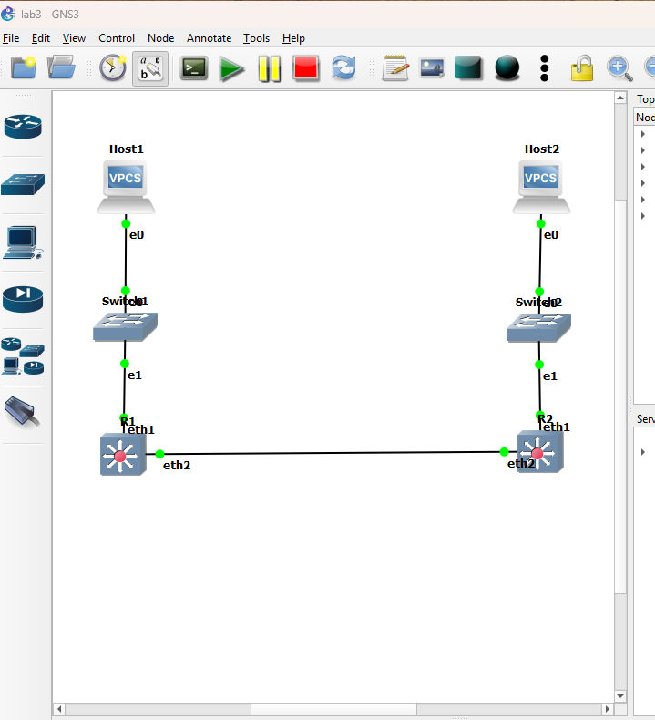
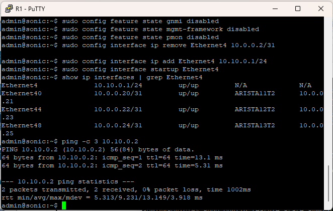
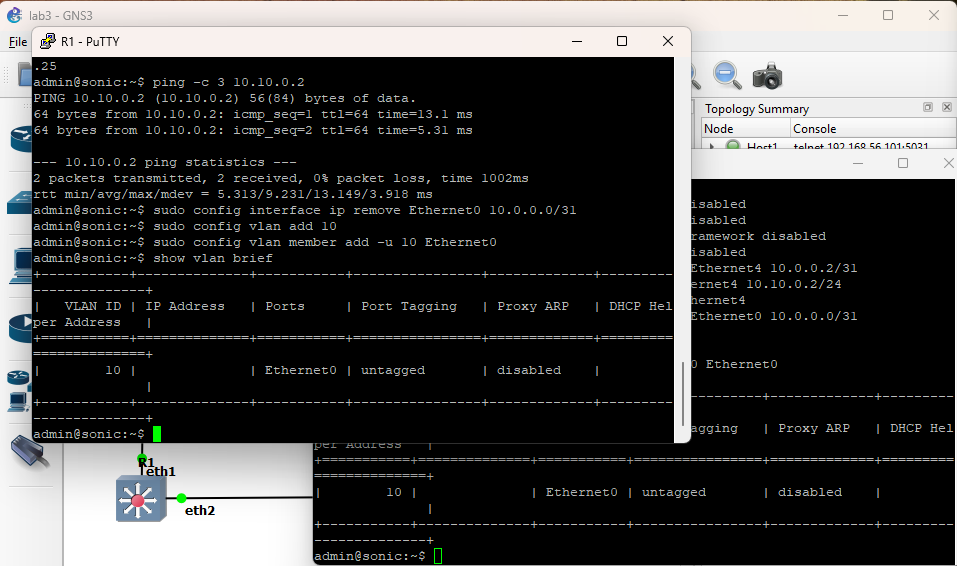
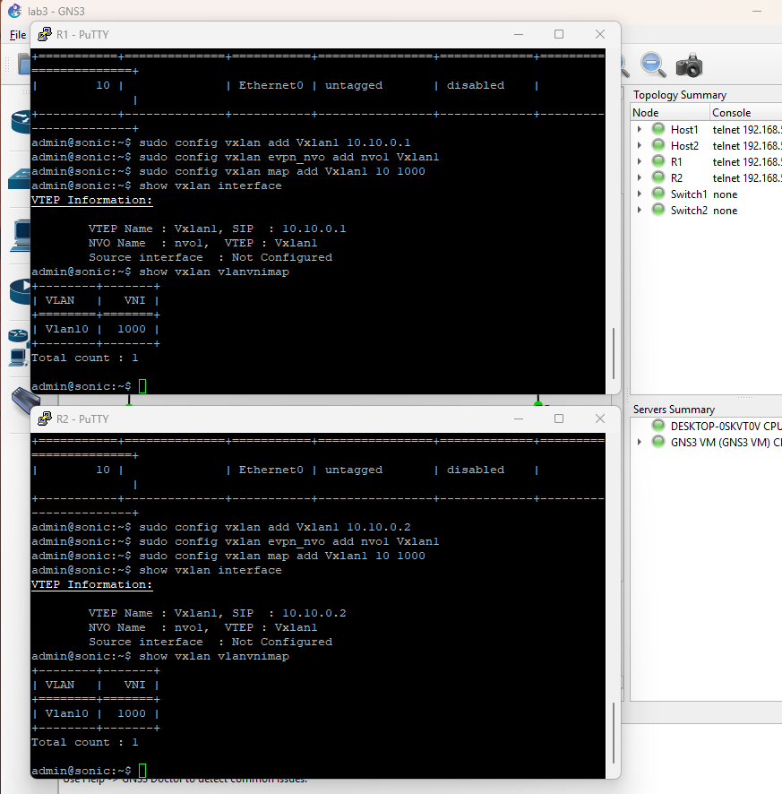
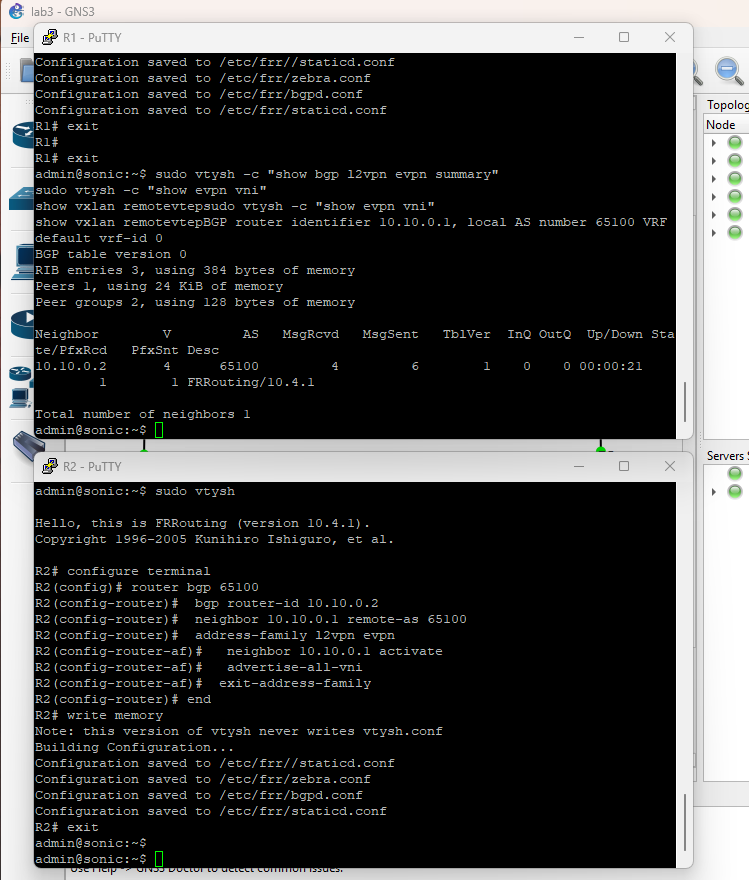
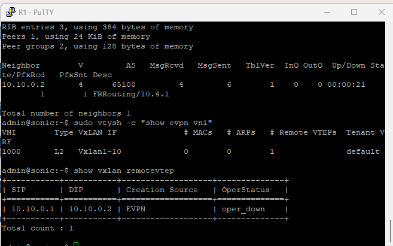
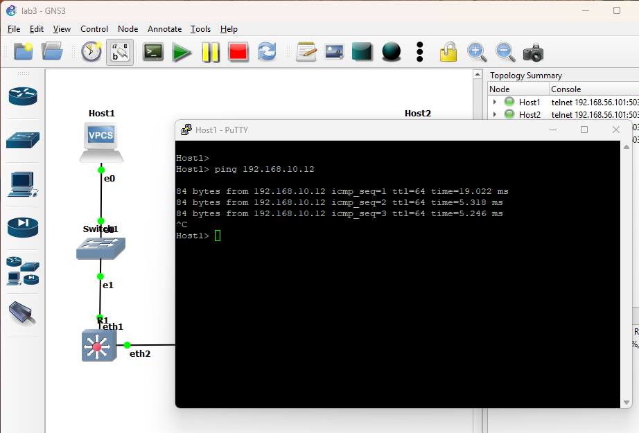
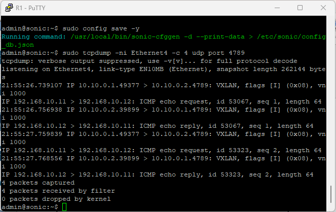
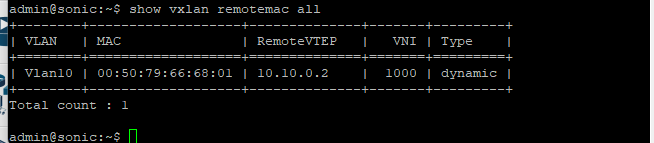

# Лабораторная работа 3. Настройка VXLAN в GNS3 на базе двух маршрутизаторов SONiC

Дисциплина «Виртуализация сетевых функций». Яковлев Игорь Сергеевич, группа К3420.

## ВВЕДЕНИЕ

Цель работы — освоить создание оверлейных сетей VXLAN в среде GNS3: настроить VXLAN на двух маршрутизаторах SONiC так, чтобы два хоста, подключённые к разным маршрутизаторам, оказались в одной L2-сети поверх IP-сети между маршрутизаторами, и проверить работу туннеля обменом данными между хостами.

Для достижения цели решались следующие задачи:

- создать в GNS3 топологию из двух маршрутизаторов SONiC, двух коммутаторов и двух хостов;
- настроить IP-адреса underlay-сети между маршрутизаторами;
- создать на каждом маршрутизаторе VLAN для хостов, VXLAN-интерфейс (VTEP) и сопоставление VLAN и VNI;
- обеспечить обнаружение удалённого VTEP и проверить связность хостов и инкапсуляцию трафика во VXLAN.

Работа выполнена на стенде из лабораторной работы 1: GNS3 2.2.61, GNS3 VM в VirtualBox 7.2.10, образ SONiC VS ветки 202511 (FRR 10.4.1). Хосты эмулируются VPCS, коммутаторы — встроенным узлом Ethernet switch GNS3.

## 1 ПРИНЦИП РАБОТЫ И ТОПОЛОГИЯ

### 1.1 Принцип VXLAN

VXLAN (Virtual eXtensible LAN, RFC 7348) — технология оверлейных сетей: Ethernet-кадры одной L2-сети упаковываются в UDP-датаграммы и передаются через обычную IP-сеть. Сеть, по которой передаются упакованные пакеты, называется underlay, а виртуальная L2-сеть поверх неё — overlay.

Упаковку и распаковку выполняет VTEP (VXLAN Tunnel End Point) — конечная точка туннеля на маршрутизаторе. VTEP берёт кадр из локального VLAN, добавляет к нему заголовок VXLAN с идентификатором сети VNI (VXLAN Network Identifier, 24 бита, до 16 млн сетей), затем заголовки UDP (порт назначения 4789), IP (адреса VTEP) и Ethernet и отправляет пакет удалённому VTEP. Удалённый VTEP снимает внешние заголовки и по VNI определяет, в какой VLAN выпустить исходный кадр.

Чтобы VTEP знал, куда отправлять широковещательные кадры и кадры для конкретных MAC-адресов, в SONiC используется BGP EVPN: маршрутизаторы обмениваются по BGP маршрутами типа 3 (о наличии VNI на VTEP) и типа 2 (о MAC-адресах за VTEP).

### 1.2 Топология

В GNS3 создан проект lab3 (рисунок 1). Каждый хост подключён к своему коммутатору, коммутатор — к порту Ethernet0 своего маршрутизатора, а маршрутизаторы соединены между собой портами Ethernet4. Соединения приведены в таблице 1.

**Таблица 1 – Соединения в топологии**

| Кабель | Узел А, порт | Узел Б, порт |
|---|---|---|
| 1 | Host1, e0 | Switch1, Ethernet0 |
| 2 | Switch1, Ethernet1 | R1, eth1 (Ethernet0) |
| 3 | R1, eth2 (Ethernet4) | R2, eth2 (Ethernet4) |
| 4 | R2, eth1 (Ethernet0) | Switch2, Ethernet1 |
| 5 | Switch2, Ethernet0 | Host2, e0 |

Проект описан файлом `lab3.gns3`, который сформирован скриптом на основе описаний узлов из предыдущих работ. Для одновременной работы двух SONiC каждому узлу выделено 3072 МБ памяти и 2 vCPU, а GNS3 VM — 7168 МБ и 4 vCPU (см. раздел 5.1).



*Рисунок 1 – Схема сети в GNS3*

### 1.3 Адресный план

Адресный план приведён в таблице 2. Underlay-сеть связывает маршрутизаторы, overlay-сеть VLAN 10 / VNI 1000 объединяет хосты в одну L2-сеть.

**Таблица 2 – Адресный план**

| Сеть | Узел | Интерфейс | Адрес | Назначение |
|---|---|---|---|---|
| 10.10.0.0/24 | R1 | Ethernet4 (eth2) | 10.10.0.1/24 | underlay, VTEP |
| 10.10.0.0/24 | R2 | Ethernet4 (eth2) | 10.10.0.2/24 | underlay, VTEP |
| VLAN 10 / VNI 1000 | R1, R2 | Ethernet0 (eth1) | — | L2-порт к хосту |
| 192.168.10.0/24 | Host1 | e0 | 192.168.10.11/24 | overlay |
| 192.168.10.0/24 | Host2 | e0 | 192.168.10.12/24 | overlay |

По сравнению с методическими указаниями изменены параметры и команды, которые не соответствуют SONiC VS (таблица 3).

**Таблица 3 – Отличия от методических указаний**

| В указаниях | В работе | Причина |
|---|---|---|
| порт Ethernet1 | Ethernet4 | порты SONiC VS нумеруются с шагом 4 (по 4 линии ASIC на порт), порта Ethernet1 нет |
| underlay 10.0.0.1/24, 10.0.0.2/24 | 10.10.0.1/24, 10.10.0.2/24 | сеть 10.0.0.0/26 занята адресами /31 стандартной конфигурации T1 на всех портах |
| `config vlan member add 10 Ethernet0` | `config vlan member add -u 10 Ethernet0` | без -u порт тегированный и не принимает кадры без метки от хоста |
| `config vxlan set source`, `mapping add` | `config vxlan add`, `config vxlan map add` | команды указаний отсутствуют в CLI SONiC |
| `config vxlan add peer` | BGP EVPN, `evpn_nvo` | в SONiC удалённые VTEP задаются через EVPN, статической команды peer нет |

## 2 НАСТРОЙКА UNDERLAY

### 2.1 Подготовка маршрутизаторов

После загрузки на каждом маршрутизаторе проверено командой `docker ps`, что запущены контейнеры database, swss, syncd и bgp, и заданы имена узлов. Для снижения нагрузки отключены службы, не нужные для работы: SNMP, gNMI, mgmt-framework и мониторинг платформы pmon.

```
sudo config hostname R1
sudo config feature state snmp disabled
sudo config feature state gnmi disabled
sudo config feature state mgmt-framework disabled
sudo config feature state pmon disabled
```

На R2 команды аналогичны, имя узла — R2. Новое имя применяется к приглашению командной строки после повторного входа, поэтому на части скриншотов приглашение ещё имеет вид admin@sonic, а в консоли FRR — уже R1# и R2#. Сообщение «Failed to start eventd.service» при смене имени связано с перезапуском служб и на работу не влияет: контейнер eventd продолжил работу.

### 2.2 Адреса underlay-сети

С порта Ethernet4 обоих маршрутизаторов удалён адрес конфигурации T1 10.0.0.2/31 — на R1 и R2 он одинаковый и создал бы конфликт. Затем назначены адреса underlay-сети и порт включён:

```
R1: sudo config interface ip remove Ethernet4 10.0.0.2/31
R1: sudo config interface ip add Ethernet4 10.10.0.1/24
R1: sudo config interface startup Ethernet4

R2: sudo config interface ip remove Ethernet4 10.0.0.2/31
R2: sudo config interface ip add Ethernet4 10.10.0.2/24
R2: sudo config interface startup Ethernet4
```

Связность underlay проверена командой `ping -c 3 10.10.0.2` с R1: ответы получены без потерь, время 5–13 мс (рисунок 2). Сеть 10.10.0.0/24 непосредственно подключена к обоим маршрутизаторам, поэтому маршрутизация в underlay не требуется.



*Рисунок 2 – Адрес Ethernet4 и ping R1 → R2 по underlay-сети*

## 3 НАСТРОЙКА OVERLAY

### 3.1 VLAN 10 для хостов

На обоих маршрутизаторах порт Ethernet0, ведущий к коммутатору и хосту, переведён в режим L2 и добавлен в VLAN 10 без тега:

```
sudo config interface ip remove Ethernet0 10.0.0.0/31
sudo config vlan add 10
sudo config vlan member add -u 10 Ethernet0
show vlan brief
```

Адрес T1 удалён, так как порт с IP-адресом является маршрутизируемым и не может быть членом VLAN. Ключ -u делает порт нетегированным (access): хост и коммутатор GNS3 передают кадры без метки 802.1Q, и маршрутизатор относит их к VLAN 10. IP-адрес на VLAN 10 не назначается — это чисто L2-сеть. Результат приведён на рисунке 3.



*Рисунок 3 – VLAN 10 с нетегированным портом Ethernet0 на R1 и R2*

### 3.2 VTEP и сопоставление VLAN и VNI

```
R1: sudo config vxlan add Vxlan1 10.10.0.1
R1: sudo config vxlan evpn_nvo add nvo1 Vxlan1
R1: sudo config vxlan map add Vxlan1 10 1000

R2: sudo config vxlan add Vxlan1 10.10.0.2
R2: sudo config vxlan evpn_nvo add nvo1 Vxlan1
R2: sudo config vxlan map add Vxlan1 10 1000
```

Команда `vxlan add` создаёт VTEP Vxlan1 с адресом-источником инкапсуляции — адресом underlay-порта маршрутизатора. Команда `evpn_nvo add` создаёт объект NVO (Network Virtualization Overlay), указывающий, что сведения об удалённых VTEP и MAC-адресах VTEP получает через EVPN. Команда `map add` связывает VLAN 10 с VNI 1000: кадры VLAN 10 передаются в туннель с идентификатором 1000. Результат проверен командами `show vxlan interface` и `show vxlan vlanvnimap` (рисунок 4).



*Рисунок 4 – VTEP Vxlan1 и сопоставление Vlan10 – VNI 1000 на R1 и R2*

### 3.3 BGP EVPN

Протоколы маршрутизации в SONiC работают в контейнере bgp (FRR) и настраиваются через консоль vtysh. Номер автономной системы взят из стандартной конфигурации (65100, одинаковый на обоих маршрутизаторах), поэтому сессия является внутренней (iBGP). Конфигурация R1:

```
R1# configure terminal
R1(config)# router bgp 65100
R1(config-router)# bgp router-id 10.10.0.1
R1(config-router)# neighbor 10.10.0.2 remote-as 65100
R1(config-router)# address-family l2vpn evpn
R1(config-router-af)# neighbor 10.10.0.2 activate
R1(config-router-af)# advertise-all-vni
R1(config-router-af)# exit-address-family
R1(config-router)# end
R1# write memory
```

На R2 задан router-id 10.10.0.2 и сосед 10.10.0.1. Идентификатор маршрутизатора указан явно, так как по умолчанию он одинаков на обоих SONiC (адрес Loopback0 10.1.0.1), а BGP-сессия между узлами с одинаковым идентификатором не устанавливается. Семейство адресов L2VPN EVPN передаёт сведения о L2-сетях, а команда `advertise-all-vni` объявляет соседу все локальные VNI.

Сессия установлена: сосед 10.10.0.2 в состоянии Established, от него получен и ему отправлен один EVPN-маршрут (рисунок 5). Это маршрут типа 3 (Inclusive Multicast Ethernet Tag), сообщающий о наличии VNI 1000 на VTEP соседа. По нему каждый маршрутизатор добавляет соседа в список рассылки широковещательного трафика VNI. Команда `show evpn vni` показывает VNI 1000 типа L2 с туннельным интерфейсом ядра Vxlan1-10 и одним удалённым VTEP, а `show vxlan remotevtep` — туннель 10.10.0.1 → 10.10.0.2, созданный через EVPN (рисунок 6).



*Рисунок 5 – BGP-сессия L2VPN EVPN между R1 и R2*



*Рисунок 6 – VNI 1000 и удалённый VTEP на R1*

### 3.4 Настройка хостов

Хосты находятся в одной IP-сети 192.168.10.0/24. Шлюз 192.168.10.1 указан по методическим указаниям и в работе не используется: обмен идёт внутри одной подсети.

```
VPCS> set pcname Host1
Host1> ip 192.168.10.11 255.255.255.0 192.168.10.1
Host1> save

VPCS> set pcname Host2
Host2> ip 192.168.10.12 255.255.255.0 192.168.10.1
Host2> save
```

MAC-адреса хостов: Host1 — 00:50:79:66:68:00, Host2 — 00:50:79:66:68:01.

### 3.5 Сохранение конфигурации

Конфигурация SONiC сохранена на обоих маршрутизаторах командой `sudo config save -y` в файл /etc/sonic/config_db.json, конфигурация BGP — командой `write memory` в файлы FRR (/etc/frr/bgpd.conf и др.).

## 4 ПРОВЕРКА РАБОТЫ VXLAN

### 4.1 Связность хостов

Ping с Host1 до Host2 успешен: получено 3 ответа из 3, время 5–19 мс (рисунок 7). Значение TTL в ответах — 64, то есть равно начальному: в отличие от лабораторной работы 2, где пакет проходил через маршрутизатор и TTL уменьшался до 63, здесь маршрутизации нет — Ethernet-кадр целиком передаётся через туннель, и хосты находятся в одной L2-сети.

```
Host1> ping 192.168.10.12
84 bytes from 192.168.10.12 icmp_seq=1 ttl=64 time=19.022 ms
84 bytes from 192.168.10.12 icmp_seq=2 ttl=64 time=5.318 ms
84 bytes from 192.168.10.12 icmp_seq=3 ttl=64 time=5.246 ms
```



*Рисунок 7 – Ping Host1 → Host2 через VXLAN*

### 4.2 Проверка инкапсуляции

Инкапсуляция подтверждена захватом трафика на underlay-порту R1 во время ping с Host1 (рисунок 8):

```
admin@sonic:~$ sudo tcpdump -ni Ethernet4 -c 4 udp port 4789
IP 10.10.0.1.49377 > 10.10.0.2.4789: VXLAN, flags [I] (0x08), vni 1000
IP 192.168.10.11 > 192.168.10.12: ICMP echo request, id 53067,
   seq 1, length 64
IP 10.10.0.2.39899 > 10.10.0.1.4789: VXLAN, flags [I] (0x08), vni 1000
IP 192.168.10.12 > 192.168.10.11: ICMP echo reply, id 53067,
   seq 1, length 64
4 packets captured
```

Каждый захваченный пакет содержит два уровня. Внешний — UDP-датаграмма между VTEP 10.10.0.1 и 10.10.0.2 на порт 4789 (стандартный порт VXLAN) с заголовком VXLAN, в котором флаг I означает наличие идентификатора сети, а VNI равен 1000. Внутренний — исходный ICMP-обмен между хостами 192.168.10.11 и 192.168.10.12. Порт источника внешнего UDP-заголовка различается для разных направлений (49377 и 39899): VTEP вычисляет его как хеш от внутреннего кадра, что позволяет распределять разные потоки по разным путям underlay-сети. Таким образом, на участке R1–R2 адреса хостов в открытом виде отсутствуют, а их трафик передаётся внутри VXLAN.



*Рисунок 8 – Захват VXLAN-трафика на порту Ethernet4 маршрутизатора R1*

### 4.3 MAC-адреса за удалённым VTEP

После обмена в таблице удалённых MAC-адресов R1 появился MAC-адрес Host2 00:50:79:66:68:01 в VLAN 10, доступный через удалённый VTEP 10.10.0.2 в VNI 1000 (рисунок 9). Этот адрес R1 получил от R2 по EVPN маршрутом типа 2 (MAC/IP Advertisement), поэтому последующие кадры для Host2 отправляются в туннель адресно, без широковещательной рассылки.



*Рисунок 9 – MAC-адрес Host2 за удалённым VTEP на R1*

### 4.4 Путь кадра через туннель

Host1 рассылает ARP-запрос о 192.168.10.12. R1 принимает кадр в VLAN 10 и, не зная получателя, рассылает его локально и в туннель всем VTEP из списка, полученного по EVPN (ingress replication). R2 распаковывает кадр, выпускает его в VLAN 10, Host2 отвечает. Далее ICMP-запрос Host1 инкапсулируется R1 и передаётся R2 адресно. Заголовки эхо-запроса на участке R1–R2 приведены в таблице 4; накладные расходы VXLAN составляют 50 байт (внешние Ethernet 14, IP 20, UDP 8 и VXLAN 8 байт), что не создаёт проблем при MTU портов SONiC 9100 байт.

**Таблица 4 – Структура пакета на участке R1–R2**

| Уровень | Поля | Значение |
|---|---|---|
| Внешний Ethernet | MAC источника / назначения | R1 (Ethernet4) / R2 (Ethernet4) |
| Внешний IP | адрес источника / назначения | 10.10.0.1 / 10.10.0.2 |
| UDP | порт источника / назначения | хеш (49377) / 4789 |
| VXLAN | флаги, VNI | I, 1000 |
| Внутренний Ethernet | MAC источника / назначения | 00:50:79:66:68:00 / 00:50:79:66:68:01 |
| Внутренний IP | адрес источника / назначения, TTL | 192.168.10.11 / 192.168.10.12, 64 |
| ICMP | тип | echo request |

## 5 ПРОБЛЕМЫ И ИХ РЕШЕНИЕ

### 5.1 Нехватка ресурсов при запуске двух SONiC

При первом запуске GNS3 VM было выделено 8192 МБ и 6 vCPU, оба маршрутизатора загружались одновременно, а на хосте с 16 ГБ памяти было свободно около 6,5 ГБ. Компьютер перестал отвечать и был перезагружен. В журнале VirtualBox ошибок не оказалось — запись просто обрывалась, то есть сбой вызван нехваткой памяти и процессорного времени хоста, а не ошибкой гипервизора.

Решение: памяти каждого SONiC уменьшена до 3072 МБ, GNS3 VM выделено 7168 МБ и 4 vCPU из 8 потоков процессора, закрыты ресурсоёмкие приложения хоста, а после загрузки на маршрутизаторах отключены неиспользуемые службы (раздел 2.1). В таком режиме оба SONiC работали стабильно: внутри GNS3 VM было занято около 5,1 ГБ из 6,8 ГБ.

### 5.2 Состояние oper_down удалённого VTEP

Команда `show vxlan remotevtep` показывает для туннеля 10.10.0.1 → 10.10.0.2 состояние oper_down, хотя трафик через туннель проходит. Это особенность SONiC VS: оперативное состояние туннеля сообщает микросхема коммутации через SAI, а программная модель ASIC его не передаёт. Данные в SONiC VS пересылает ядро Linux через созданный SONiC туннельный интерфейс Vxlan1-10, поэтому фактическую работу туннеля подтверждают ping, захват трафика и изученные MAC-адреса.

## ЗАКЛЮЧЕНИЕ

В ходе работы в GNS3 построена топология из двух маршрутизаторов SONiC, двух коммутаторов и двух хостов. Маршрутизаторы соединены underlay-сетью 10.10.0.0/24, связность которой подтверждена командой ping.

На каждом маршрутизаторе порт к хосту переведён в VLAN 10 без тега, создан VTEP Vxlan1 с адресом-источником в underlay-сети и VLAN 10 сопоставлена с VNI 1000. Обнаружение удалённого VTEP и MAC-адресов организовано через BGP EVPN между R1 и R2 — штатный механизм SONiC, заменяющий отсутствующую в CLI команду статического указания соседа.

Host1 и Host2 оказались в одной логической сети поверх VXLAN: ping проходит с TTL 64, то есть без маршрутизации. Захват трафика на underlay-порту показал UDP-пакеты между VTEP на порт 4789 с заголовком VXLAN (VNI 1000) и вложенным ICMP-обменом хостов, а R1 изучил MAC-адрес Host2 за удалённым VTEP.

Также установлено, что команды VXLAN из методических указаний не соответствуют CLI SONiC, а одновременная работа двух экземпляров SONiC VS требует аккуратного распределения памяти и процессорного времени хоста.
