# Лабораторная работа 4. Настройка OpenFlow в GNS3 с использованием OpenDaylight и маршрутизаторов SONiC

Дисциплина «Виртуализация сетевых функций». Яковлев Игорь Сергеевич, группа К3420.

## ВВЕДЕНИЕ

Цель работы — изучить основы программно-определяемых сетей (SDN) и протокола OpenFlow, настроить в GNS3 сеть, в которой коммутаторы на базе SONiC работают под управлением внешнего SDN-контроллера OpenDaylight (ODL), и продемонстрировать централизованное управление потоками (flows).

Для достижения цели решались следующие задачи:

- развернуть контроллер OpenDaylight в GNS3 в виде Docker-контейнера;
- установить на двух узлах SONiC программный коммутатор Open vSwitch (OVS), настроить его на работу по протоколу OpenFlow 1.3 и подключить к ODL;
- подключить Host1 к первому коммутатору, Host2 ко второму, а коммутаторы связать между собой;
- установить через RESTCONF API контроллера базовые потоки и проверить связность хостов;
- изменить таблицу потоков (заблокировать ICMP) и показать влияние изменения на трафик между хостами.

Работа выполнена на стенде из предыдущих работ: GNS3 2.2.61, GNS3 VM в VirtualBox 7.2.10 (4 vCPU, 7168 МБ), образ SONiC VS ветки 202511 на базе Debian 13 с ядром Linux 6.12. Хосты эмулируются VPCS. Контроллер — OpenDaylight выпуска Chromium (Karaf 0.24.0, Java 21), коммутатор — Open vSwitch 3.5.0.

## 1 ПРИНЦИП РАБОТЫ И ТОПОЛОГИЯ

### 1.1 SDN и протокол OpenFlow

В традиционной сети каждое устройство само строит таблицы пересылки: протоколы маршрутизации и обучение MAC-адресов работают на каждом коммутаторе (плоскость управления, control plane), а пересылка пакетов по этим таблицам — плоскость данных (data plane) — выполняется там же. В SDN плоскость управления вынесена в отдельный контроллер: коммутаторы только пересылают пакеты по правилам, а правила для всей сети централизованно вычисляет и устанавливает контроллер.

OpenFlow — открытый протокол взаимодействия контроллера и коммутатора. Коммутатор OpenFlow содержит одну или несколько таблиц потоков. Запись таблицы (flow entry) состоит из условия (match: входной порт, MAC- и IP-адреса, тип протокола и т. д.), приоритета, набора инструкций и действий (переслать в порт, отбросить, отправить контроллеру, изменить поля), счётчиков пакетов и байтов, а также идентификатора cookie, который задаёт контроллер. Для каждого пакета применяется совпавшая запись с наибольшим приоритетом. Если не совпала ни одна запись, срабатывает запись table-miss (приоритет 0): обычно она отправляет пакет контроллеру сообщением packet-in.

Коммутатор сам устанавливает TCP-соединение с контроллером. Стандартный порт OpenFlow — 6653 (выделен IANA), порт 6633 использовался до его выделения и по-прежнему поддерживается. В работе используется версия протокола OpenFlow 1.3.

### 1.2 OpenDaylight

OpenDaylight — SDN-контроллер с открытым кодом на платформе Java (OSGi-контейнер Apache Karaf). Состояние сети в ODL описывается YANG-моделями и хранится в двух хранилищах MD-SAL: конфигурационном (config) — то, что задано администратором или приложением, и оперативном (operational) — то, что фактически получено от устройств. Модуль openflowplugin поддерживает соединения с коммутаторами, публикует их порты в оперативном хранилище (инвентарь), устанавливает на коммутаторы потоки из конфигурационного хранилища (Forwarding Rules Manager), собирает статистику и обнаруживает связи между коммутаторами по LLDP. Внешний доступ к хранилищам предоставляет северный интерфейс RESTCONF (RFC 8040) на порту 8181.

### 1.3 Open vSwitch внутри SONiC

Используемый образ SONiC VS не поддерживает OpenFlow напрямую, поэтому, как предложено в методических указаниях, внутри SONiC установлен Open vSwitch. В SONiC VS порты виртуальной машины eth1, eth2, … обслуживает программная модель ASIC (контейнер syncd): для каждого из них в ядре Linux создан интерфейс Ethernet0, Ethernet4, …, и кадры, принятые портом, передаются в этот интерфейс и обратно. В работе интерфейсы Ethernet0 (к хосту) и Ethernet4 (ко второму коммутатору) включены в мост OVS br0. Решение о пересылке кадра принимает модуль ядра openvswitch по таблице потоков, которую формирует контроллер, а SONiC выполняет роль платформы: предоставляет порты, сетевой стек и интерфейс управления.

На аппаратном коммутаторе SONiC такой подход означал бы пересылку всего трафика через центральный процессор, поэтому в промышленных решениях OpenFlow реализуется в конвейере ASIC. Для учебного стенда на SONiC VS, где пересылка и так программная, это не имеет значения.

### 1.4 Топология

В GNS3 создан проект lab4 (рисунок 1). Сеть данных повторяет схему методических указаний: Host1 подключён к SW1, Host2 — к SW2, коммутаторы соединены портами Ethernet4. Для связи с контроллером добавлена отдельная сеть управления: интерфейсы eth0 обоих SONiC и контейнер ODL подключены к коммутатору MgmtSwitch, а он — к узлу NAT1, который соединяет сеть 192.168.42.0/24 с GNS3 VM и предоставляет выход в интернет для установки пакетов. Таким образом, OpenFlow-соединения идут вне сети данных (out-of-band). Соединения приведены в таблице 1.

**Таблица 1 – Соединения в топологии**

| Кабель | Узел А, порт | Узел Б, порт |
|---|---|---|
| 1 | NAT1, nat0 | MgmtSwitch, Ethernet0 |
| 2 | MgmtSwitch, Ethernet1 | ODL, eth0 |
| 3 | MgmtSwitch, Ethernet2 | SW1, eth0 (управление) |
| 4 | MgmtSwitch, Ethernet3 | SW2, eth0 (управление) |
| 5 | Host1, e0 | SW1, eth1 (Ethernet0) |
| 6 | SW1, eth2 (Ethernet4) | SW2, eth2 (Ethernet4) |
| 7 | SW2, eth1 (Ethernet0) | Host2, e0 |

Проект описан файлом `lab4.gns3`, сформированным скриптом `make-topology.ps1`. Каждому SONiC выделено 3072 МБ памяти и 2 vCPU.

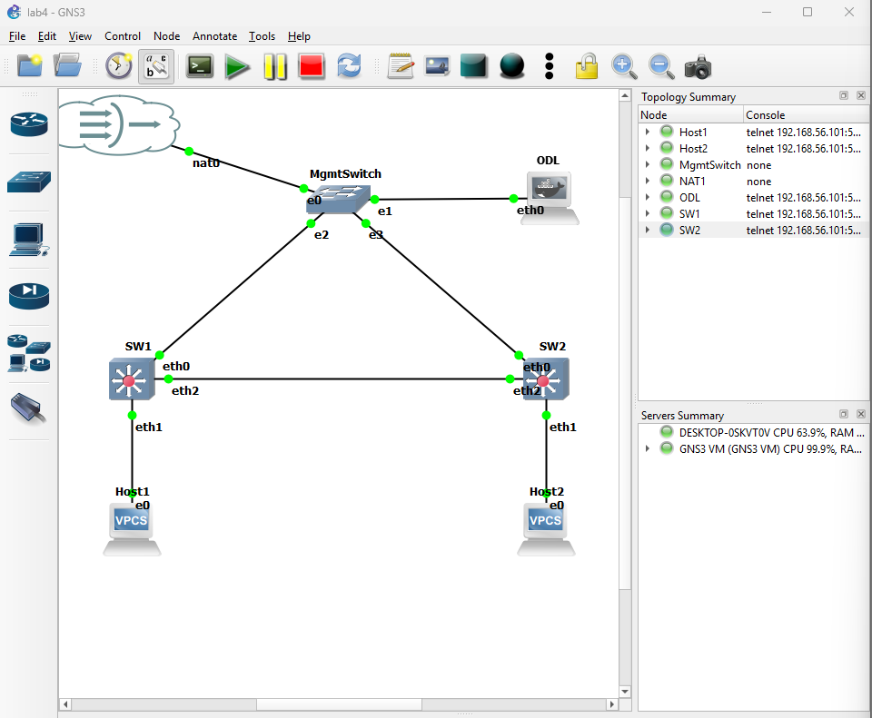

*Рисунок 1 – Схема сети в GNS3*

### 1.5 Адресный план

Адреса и идентификаторы приведены в таблице 2. Хосты находятся в одной IP-сети: коммутаторы работают на втором уровне и пересылают кадры по правилам OpenFlow, без маршрутизации.

**Таблица 2 – Адресный план**

| Сеть | Узел | Интерфейс | Адрес / идентификатор |
|---|---|---|---|
| 192.168.42.0/24 (управление) | GNS3 VM | virbr0 (NAT1) | 192.168.42.1 — шлюз и DNS |
|  | ODL | eth0 | 192.168.42.10/24, порты 6633, 6653, 8181 |
|  | SW1 | eth0 | 192.168.42.11/24 |
|  | SW2 | eth0 | 192.168.42.12/24 |
| 192.168.1.0/24 (данные) | Host1 | e0 | 192.168.1.11/24, MAC 00:50:79:66:68:00 |
|  | Host2 | e0 | 192.168.1.12/24, MAC 00:50:79:66:68:01 |
| OpenFlow | SW1 | br0 | datapath-id 1 → узел openflow:1 |
|  | SW2 | br0 | datapath-id 2 → узел openflow:2 |
|  | SW1, SW2 | Ethernet0 / Ethernet4 | порты OpenFlow 1 / 2 |

### 1.6 Отличия от методических указаний

Часть рекомендаций методических указаний относится к старым версиям OpenDaylight или не соответствует SONiC VS. Внесённые изменения приведены в таблице 3.

**Таблица 3 – Отличия от методических указаний**

| В указаниях | В работе | Причина |
|---|---|---|
| образ `opendaylight/odl:latest` | собственный образ на основе официального дистрибутива ODL Chromium | образ на Docker Hub не обновлялся с 2017 года (выпуски 5.x–6.x, Java 8) |
| RESTCONF `/restconf/config/...` | RESTCONF RFC 8040 `/rests/data/...` | в актуальных версиях ODL доступна только реализация по RFC 8040 |
| L2switch для «прозрачной» коммутации | потоки задаются вручную через RESTCONF | проект L2switch отсутствует в актуальных выпусках ODL |
| Web-интерфейс ODL | OpenAPI explorer и ответы RESTCONF в браузере | прежний интерфейс DLUX удалён из ODL |
| контроллер 192.168.100.10 | 192.168.42.10 | адрес в сети управления, созданной узлом NAT GNS3 |
| порт Ethernet1 | Ethernet4 | порты SONiC VS нумеруются с шагом 4, порта Ethernet1 нет |
| — | `fail-mode=secure`, `datapath-id`, `ofport_request` | предсказуемые идентификаторы и пересылка только по правилам контроллера (раздел 3.3) |

## 2 РАЗВЁРТЫВАНИЕ OPENDAYLIGHT

### 2.1 Docker-образ контроллера

Выбран вариант A методических указаний — Docker-контейнер. Готовый образ `opendaylight/odl` на Docker Hub устарел, поэтому в GNS3 VM собран собственный образ `odl-lab:chromium` из официального дистрибутива ODL Chromium (`karaf-0.24.0.tar.gz` из репозитория Nexus проекта OpenDaylight) на базе образа Eclipse Temurin с Java 21:

```
FROM eclipse-temurin:21-jre
RUN apt-get update && apt-get install -y --no-install-recommends \
    iproute2 iputils-ping curl jq procps
ADD karaf-0.24.0.tar.gz /opt/
RUN mv /opt/karaf-0.24.0 /opt/odl && sed -i '...featuresBoot...' \
    /opt/odl/etc/org.apache.karaf.features.cfg
ENV JAVA_MAX_MEM=1024m
COPY entrypoint.sh /entrypoint.sh
EXPOSE 6653 8181
ENTRYPOINT ["/entrypoint.sh"]
```

Дистрибутив ODL по умолчанию не загружает прикладных модулей, поэтому в список автозагрузки `featuresBoot` добавлены три модуля:

- `odl-openflowplugin-flow-services-rest` — поддержка OpenFlow (соединения, инвентарь, установка потоков, статистика, обнаружение топологии по LLDP) вместе с RESTCONF;
- `odl-openflowplugin-app-table-miss-enforcer` — установка на каждый подключившийся коммутатор записи table-miss «отправлять контроллеру»;
- `odl-restconf-openapi` — описание RESTCONF API в формате OpenAPI и веб-интерфейс для работы с ним.

Сценарий запуска `entrypoint.sh` назначает интерфейсу eth0 контейнера адрес и шлюз из переменных окружения `ODL_ADDR` и `ODL_GW` (в сети управления нет DHCP для контейнера) и запускает Karaf в режиме сервера.

### 2.2 Узел ODL в GNS3

В проект добавлен узел типа Docker с образом `odl-lab:chromium`, одним сетевым адаптером, консолью telnet и переменными окружения `ODL_ADDR=192.168.42.10/24` и `ODL_GW=192.168.42.1`. После запуска в консоли узла выводится адрес управления и сообщение о запуске Karaf (рисунок 2). Через 20–30 секунд контроллер принимает соединения на портах 6633 и 6653 (OpenFlow) и 8181 (RESTCONF), что проверено из GNS3 VM командой `nc -zv 192.168.42.10 <порт>`. Контейнер занимает около 715 МБ памяти.

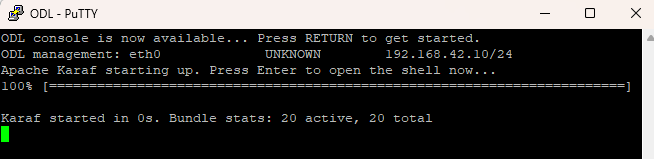

*Рисунок 2 – Консоль узла ODL в GNS3*

Учётные данные RESTCONF — стандартные для ODL (admin/admin). Запросы к контроллеру выполнялись из GNS3 VM, имеющей адрес 192.168.42.1 в сети управления, а для работы из браузера на компьютере порт 8181 контроллера был проброшен SSH-туннелем через GNS3 VM на адрес 127.0.0.1:8181.

## 3 НАСТРОЙКА OPEN VSWITCH НА SONIC

### 3.1 Подготовка SONiC

После загрузки каждому SONiC задано имя и статический адрес интерфейса управления eth0 со шлюзом 192.168.42.1, для доступа из GNS3 VM добавлен SSH-ключ. Затем отключены службы, которые не используются при работе в режиме OpenFlow и занимают память, удалены адреса стандартной конфигурации T1 с портов, передаваемых в OVS, задан DNS-сервер и сохранена конфигурация. Команды для SW1 (для SW2 — имя SW2 и адрес 192.168.42.12):

```
sudo config hostname SW1
sudo config interface ip add eth0 192.168.42.11/24 192.168.42.1
for f in bgp snmp gnmi mgmt-framework pmon lldp radv teamd eventd
do sudo config feature state $f disabled; done
sonic-db-cli CONFIG_DB del 'INTERFACE|Ethernet0|10.0.0.0/31'
sonic-db-cli CONFIG_DB del 'INTERFACE|Ethernet4|10.0.0.2/31'
sonic-db-cli CONFIG_DB del 'INTERFACE|Ethernet0'
sonic-db-cli CONFIG_DB del 'INTERFACE|Ethernet4'
sudo config dns nameserver add 192.168.42.1
sudo config save -y
```

Порт, включённый в мост OVS, не должен иметь собственного IP-адреса: иначе ядро SONiC обрабатывало бы часть кадров само. Адреса удалены непосредственно из базы CONFIG_DB, так как команда `config interface ip remove` при отключённой службе BGP завершается ошибкой (раздел 6.2). Отключение BGP и LLDP также исключает служебный трафик SONiC в портах моста.

### 3.2 Установка Open vSwitch

SONiC 202511 построен на Debian 13, поэтому OVS установлен из стандартного репозитория Debian командами из методических указаний. Модуль ядра openvswitch присутствует в ядре SONiC, и OVS использует штатный быстрый путь в ядре (kernel datapath).

```
admin@SW1:~$ sudo apt-get update
admin@SW1:~$ sudo apt-get install -y openvswitch-switch
admin@SW1:~$ ovs-vsctl --version
ovs-vsctl (Open vSwitch) 3.5.0
admin@SW1:~$ lsmod | grep ^openvswitch
openvswitch           225280  0
```

### 3.3 Мост br0 и подключение к контроллеру

```
sudo ovs-vsctl add-br br0 -- set bridge br0 \
     protocols=OpenFlow13 fail-mode=secure \
     other-config:datapath-id=0000000000000001
sudo ovs-vsctl add-port br0 Ethernet0 \
     -- set interface Ethernet0 ofport_request=1
sudo ovs-vsctl add-port br0 Ethernet4 \
     -- set interface Ethernet4 ofport_request=2
sudo ovs-vsctl set-controller br0 tcp:192.168.42.10:6633
```

Назначение параметров:

- `protocols=OpenFlow13` — коммутатор согласует с контроллером только OpenFlow 1.3;
- `fail-mode=secure` — без правил контроллера трафик не пересылается: в режиме по умолчанию (standalone) при отсутствии связи с контроллером OVS работал бы как обычный обучающийся коммутатор, и хосты связались бы без участия ODL;
- `datapath-id` — 64-битный идентификатор коммутатора, из которого ODL формирует имя узла `openflow:<номер>`; без него идентификатор вычисляется из MAC-адреса моста и получается длинным;
- `ofport_request` — фиксированные номера портов OpenFlow (Ethernet0 — 1, Ethernet4 — 2), на которые ссылаются правила;
- `set-controller` — адрес и порт контроллера; использован порт 6633 из методических указаний.

На SW2 команды те же, `datapath-id` равен 0000000000000002. Вывод `sudo ovs-vsctl show` на обоих коммутаторах (рисунки 3 и 4) показывает мост br0 с портами Ethernet0, Ethernet4 и внутренним портом br0, режим secure и соединение с контроллером в состоянии `is_connected: true`. Конфигурация OVS хранится в его базе `/etc/openvswitch/conf.db`, служба `openvswitch-switch` включена в автозагрузку.

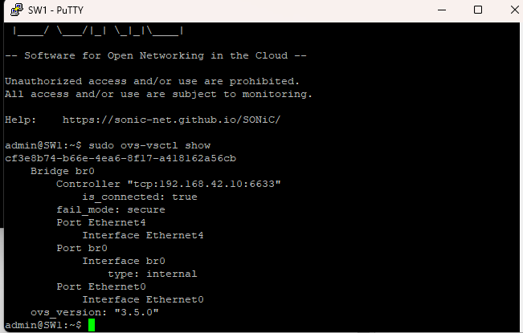

*Рисунок 3 – Конфигурация OVS на SW1*

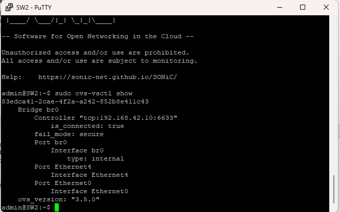

*Рисунок 4 – Конфигурация OVS на SW2*

Хостам заданы адреса командами VPCS `ip 192.168.1.11/24` и `ip 192.168.1.12/24`, настройки сохранены командой `save`.

## 4 OPENFLOW-КОММУТАТОРЫ В OPENDAYLIGHT

### 4.1 Подключение коммутаторов

Сразу после выполнения `set-controller` в журнале контроллера (`/opt/odl/data/log/karaf.log`) появились записи об OpenFlow-сессиях обоих коммутаторов (фрагмент, служебные поля сокращены):

```
19:14:50 ContextChainHolderImpl | Device openflow:1 connected.
19:14:50 DeviceManagerImpl | ConnectionEvent: Device connected
         to controller, Device:/192.168.42.11:46446
19:14:51 ContextChainHolderImpl | Role MASTER was granted to
         device openflow:1
19:28:36 ContextChainHolderImpl | Device openflow:2 connected.
19:28:36 DeviceManagerImpl | ConnectionEvent: Device connected
         to controller, Device:/192.168.42.12:41140
19:28:36 ContextChainHolderImpl | Role MASTER was granted to
         device openflow:2
```

Контроллер принял соединение, получил от коммутатора описание (OFPT_FEATURES_REPLY с datapath-id и списком портов) и занял роль MASTER — единственного контроллера, которому разрешено изменять таблицы коммутатора. Затем модуль table-miss-enforcer установил на каждый коммутатор запись с cookie 0xa:

```
admin@SW1:~$ sudo ovs-ofctl -O OpenFlow13 dump-flows br0
 cookie=0xa, duration=4.907s, table=0, n_packets=0, n_bytes=0,
   send_flow_rem priority=0 actions=CONTROLLER:65535
```

### 4.2 Инвентарь контроллера

Оперативное хранилище ODL запрошено через RESTCONF в браузере (рисунок 5). Параметр `fields` оставляет в ответе только идентификаторы и описание узлов:

```
http://127.0.0.1:8181/rests/data/opendaylight-inventory:nodes
  ?content=nonconfig&fields=node(id;flow-node-inventory:manufacturer;
  flow-node-inventory:hardware;flow-node-inventory:software;
  flow-node-inventory:ip-address;node-connector(id;
  flow-node-inventory:name))
```

Контроллер видит два узла: openflow:1 с адресом 192.168.42.11 и openflow:2 с адресом 192.168.42.12. Для обоих указаны производитель Nicira, Inc., тип Open vSwitch и версия 3.5.0. Порты узла (node-connector) имеют идентификаторы вида openflow:<узел>:<порт>: openflow:1:1 — Ethernet0, openflow:1:2 — Ethernet4, openflow:1:LOCAL — внутренний порт моста br0.

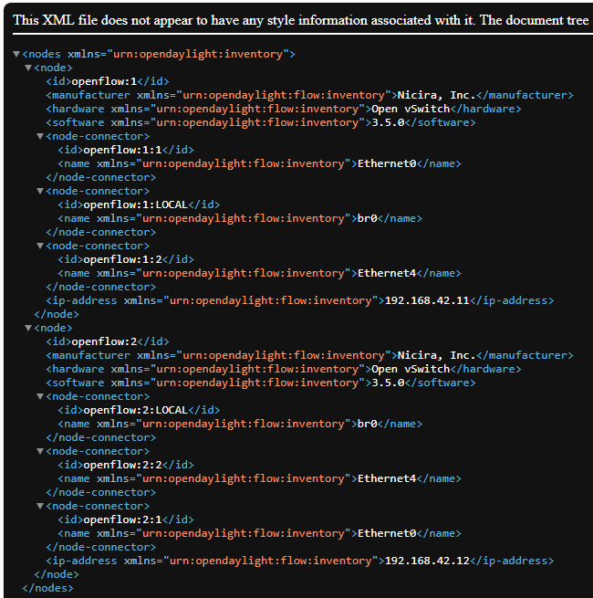

*Рисунок 5 – Коммутаторы в инвентаре OpenDaylight*

### 4.3 Топология, обнаруженная по LLDP

ODL периодически отправляет через каждый порт коммутаторов LLDP-кадр (сообщение packet-out). Кадр, отправленный из порта 2 SW1, принимается портом 2 SW2 и по записи table-miss возвращается контроллеру (packet-in), по нему контроллер определяет связь между портами. В топологии flow:1 присутствуют оба узла с их портами (termination-point) и связь в двух направлениях: openflow:1:2 ↔ openflow:2:2, что соответствует кабелю SW1 Ethernet4 — SW2 Ethernet4. На рисунке 6 приведена нижняя часть ответа: узел openflow:1 и обе связи.

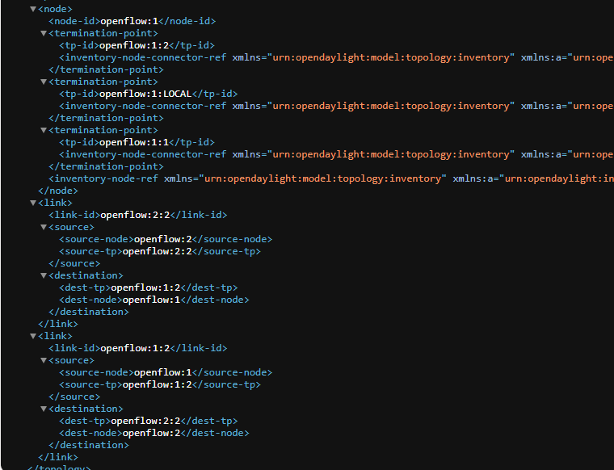

*Рисунок 6 – Связи между коммутаторами в топологии flow:1 до установки потоков*

### 4.4 Веб-интерфейс

Веб-интерфейсом актуальных версий ODL является OpenAPI explorer (`/openapi/explorer/index.html`, рисунок 7): он содержит описание всех RESTCONF-ресурсов, построенное по YANG-моделям загруженных модулей, и позволяет выполнять запросы GET, PUT, POST, PATCH и DELETE из браузера.

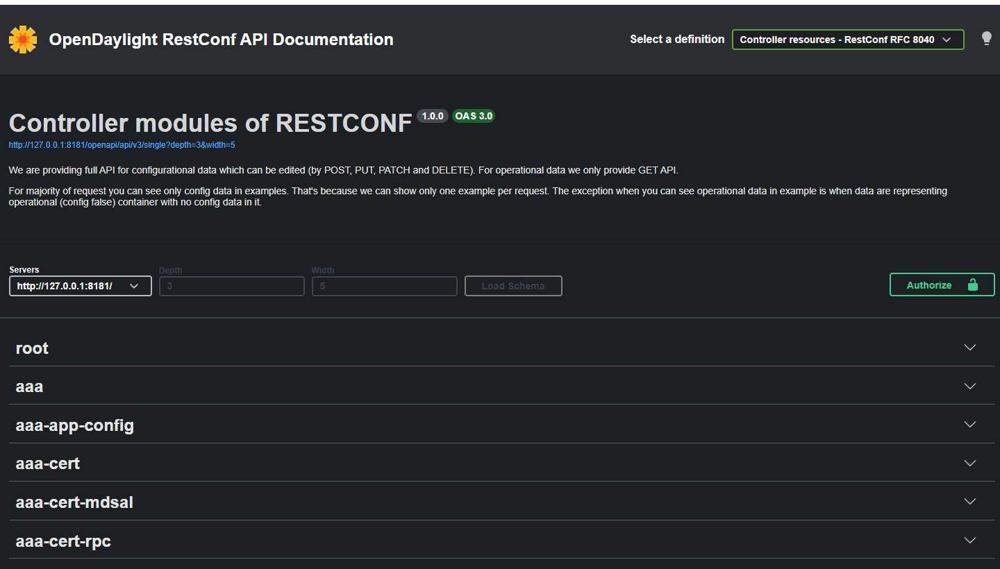

*Рисунок 7 – OpenAPI explorer — веб-интерфейс RESTCONF OpenDaylight*

## 5 УПРАВЛЕНИЕ ПОТОКАМИ

### 5.1 Проверка до установки потоков

До установки правил ping с Host1 до Host2 не проходит:

```
VPCS> ping 192.168.1.12
host (192.168.1.12) not reachable
```

ARP-запрос Host1 поступает на SW1, совпадает только с записью table-miss и передаётся контроллеру, при этом счётчик записи увеличивается. Модуля, который пересылал бы такие пакеты (L2switch), в ODL нет, поэтому запрос не доходит до Host2. Благодаря режиму secure коммутатор и не пытается переслать кадр самостоятельно. Таким образом, связность хостов полностью определяется правилами, которые установит контроллер.

### 5.2 Базовые потоки

Для связи хостов на каждом коммутаторе нужны два правила: кадры с порта хоста направлять в порт к соседнему коммутатору, и наоборот (таблица 4). Правила не зависят от адресов, поэтому пропускают и ARP, и IP-трафик. В поле cookie всех правил записан номер ИСУ 315907 (0x4d203), чтобы их можно было отличить от записей контроллера.

**Таблица 4 – Потоки в таблице 0**

| Идентификатор | Узел | Приоритет | Условие | Действие |
|---|---|---|---|---|
| yakovlev-s1-1to2 | openflow:1 | 500 | in_port = 1 (Ethernet0) | output: 2 |
| yakovlev-s1-2to1 | openflow:1 | 500 | in_port = 2 (Ethernet4) | output: 1 |
| yakovlev-s2-1to2 | openflow:2 | 500 | in_port = 1 (Ethernet0) | output: 2 |
| yakovlev-s2-2to1 | openflow:2 | 500 | in_port = 2 (Ethernet4) | output: 1 |
| yakovlev-acl-icmp (раздел 5.4) | openflow:1 | 507 | IPv4, протокол 1 (ICMP) | drop |
| table-miss (от ODL) | оба | 0 | любой пакет | CONTROLLER |

Каждое правило описывается JSON-документом по YANG-модели `flow-node-inventory`. Правило yakovlev-s1-1to2:

```
{ "flow-node-inventory:flow": [ {
    "id": "yakovlev-s1-1to2",
    "table_id": 0,
    "flow-name": "SW1: Host1 (Ethernet0) -> SW2 (Ethernet4)",
    "priority": 500,
    "cookie": 315907,
    "match": { "in-port": "openflow:1:1" },
    "instructions": { "instruction": [ { "order": 0,
      "apply-actions": { "action": [ { "order": 0,
        "output-action": { "output-node-connector": "2",
                           "max-length": 65535 } } ] } } ] }
} ] }
```

Правило записывается в конфигурационное хранилище ODL запросом PUT. Адрес ресурса включает узел, таблицу и идентификатор правила (двоеточие в имени узла кодируется как %3A):

```
curl -u admin:admin -X PUT -H 'Content-Type: application/json' \
  -d @flows/yakovlev-s1-1to2.json \
  http://192.168.42.10:8181/rests/data/opendaylight-inventory:nodes\
/node=openflow%3A1/flow-node-inventory:table=0\
/flow=yakovlev-s1-1to2
HTTP 201
```

Аналогично установлены остальные три правила; на все запросы получен ответ 201 Created. Для запросов написан сценарий `odl.sh` (команды `put`, `del`, `nodes`, `table`). Forwarding Rules Manager контроллера сразу передал правила на коммутаторы сообщениями OFPT_FLOW_MOD (рисунок 8):

```
admin@SW1:~$ sudo ovs-ofctl -O OpenFlow13 dump-flows br0
 cookie=0x4d203, table=0, n_packets=4, priority=500,
   in_port=Ethernet0 actions=output:Ethernet4
 cookie=0x4d203, table=0, n_packets=21, priority=500,
   in_port=Ethernet4 actions=output:Ethernet0
 cookie=0xa, table=0, n_packets=113, send_flow_rem
   priority=0 actions=CONTROLLER:65535
```

В листинге опущены поля duration и n_bytes. Утилита ovs-ofctl заменяет номера портов их именами: in_port=Ethernet0 соответствует порту 1, output:Ethernet4 — порту 2.

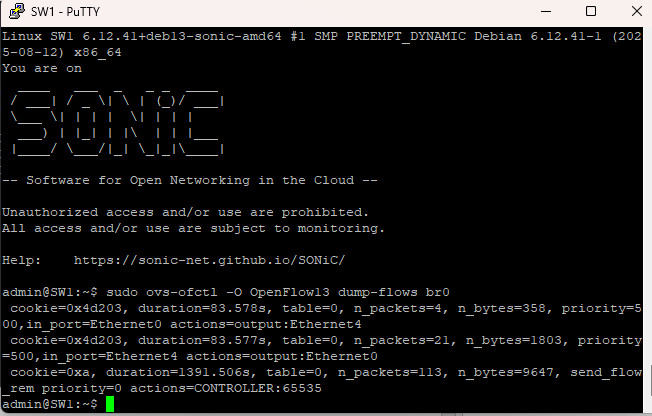

*Рисунок 8 – Таблица потоков SW1 после установки правил*

### 5.3 Проверка связности

После установки правил ping с Host1 до Host2 проходит (рисунок 9; в верхней части рисунка — неудачная попытка до установки правил). TTL в ответах равен 64, то есть пакеты не маршрутизируются: коммутаторы только передают кадры из порта в порт. Счётчики n_packets правил растут с каждым запросом и ответом. Те же счётчики ODL периодически запрашивает у коммутаторов и публикует в оперативном хранилище (раздел 5.4).

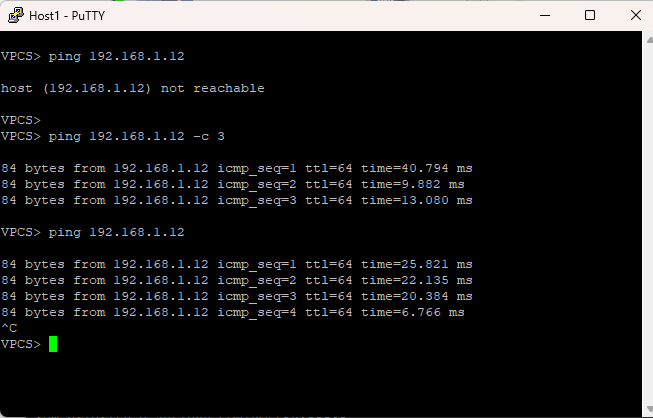

*Рисунок 9 – Ping Host1 → Host2 до и после установки потоков*

### 5.4 Изменение таблицы потоков: блокировка ICMP

В качестве примера изменения потоков на SW1 добавлено правило, отбрасывающее ICMP. Его приоритет 507 выше приоритета пересылающих правил (500), поэтому ICMP-пакеты совпадают с ним раньше. Остальной трафик по-прежнему совпадает с правилами пересылки.

```
{ "flow-node-inventory:flow": [ {
    "id": "yakovlev-acl-icmp", "table_id": 0, "priority": 507,
    "cookie": 315907,
    "match": {
      "ethernet-match": { "ethernet-type": { "type": 2048 } },
      "ip-match": { "ip-protocol": 1 } },
    "instructions": { "instruction": [ { "order": 0,
      "apply-actions": { "action": [
        { "order": 0, "drop-action": {} } ] } } ] }
} ] }
```

Тип Ethernet 2048 (0x0800) означает IPv4, протокол IP 1 — ICMP; в OpenFlow поле ip_proto можно проверять только вместе с типом Ethernet. Правило установлено тем же запросом PUT (ответ 201) и появилось в таблице SW1 в виде `priority=507,icmp actions=drop` (рисунок 11). Результат на трафике (рисунок 10):

```
VPCS> ping 192.168.1.12
192.168.1.12 icmp_seq=1 timeout
192.168.1.12 icmp_seq=2 timeout
192.168.1.12 icmp_seq=3 timeout
VPCS> ping 192.168.1.12 -P 6 -p 80
Connect   80@192.168.1.12 seq=1 ttl=64 time=63.260 ms
SendData  80@192.168.1.12 seq=1 ttl=64 time=12.411 ms
Close     80@192.168.1.12 seq=1 ttl=64 time=19.106 ms
```

Эхо-запросы ICMP отбрасываются на SW1, а TCP-соединение с портом 80 Host2 (ping VPCS с ключом -P 6) устанавливается и закрывается: блокируется только выбранный протокол. Счётчик правила на коммутаторе и статистика в оперативном хранилище ODL показывают по 5 отброшенных пакетов:

```
{"id":"yakovlev-s1-1to2","priority":500,"pkts":"29"}
{"id":"#UF$TABLE*0-1","priority":0,"pkts":"113"}
{"id":"yakovlev-s1-2to1","priority":500,"pkts":"77"}
{"id":"yakovlev-acl-icmp","priority":507,"pkts":"5"}
```

Запись `#UF$TABLE*0-1` — это правило table-miss: оно установлено модулем ODL напрямую, а не через конфигурационное хранилище, поэтому контроллер присвоил ему служебный идентификатор.

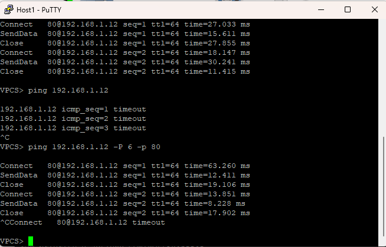

*Рисунок 10 – ICMP заблокирован, TCP проходит*

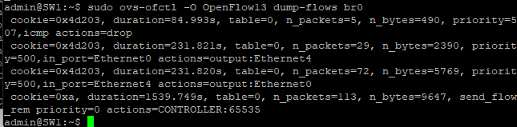

*Рисунок 11 – Правило блокировки ICMP в таблице потоков SW1*

### 5.5 Удаление правила

Правило удалено из конфигурационного хранилища запросом DELETE (ответ 204 No Content), после чего контроллер удалил его и с коммутатора. В таблице SW1 остались только пересылающие правила и table-miss, ping с Host1 до Host2 снова проходит (рисунок 12).

```
curl -u admin:admin -X DELETE http://192.168.42.10:8181/rests/data\
/opendaylight-inventory:nodes/node=openflow%3A1\
/flow-node-inventory:table=0/flow=yakovlev-acl-icmp
HTTP 204
```

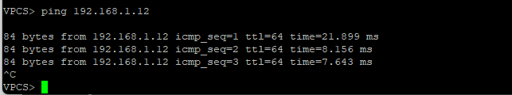

*Рисунок 12 – Ping Host1 → Host2 после удаления правила*

### 5.6 Влияние потоков на обнаружение топологии

После установки пересылающих правил связь openflow:1:2 ↔ openflow:2:2 исчезла из топологии ODL, а узлы остались. LLDP-кадр контроллера, принятый портом 2, теперь совпадает с правилом `in_port=2 actions=output:1` (приоритет 500) и отправляется к хосту, а не контроллеру: правило table-miss с приоритетом 0 до него не доходит. Чтобы сохранить обнаружение топологии, достаточно добавить правило с большим приоритетом, отправляющее кадры LLDP (тип Ethernet 0x88cc) контроллеру. Пример показывает, что порядок применения правил определяется только приоритетом, и правила разных приложений контроллера должны быть согласованы.

## 6 ПРОБЛЕМЫ И ИХ РЕШЕНИЕ

### 6.1 Одинаковый MAC-адрес интерфейсов управления

После настройки адресов SW2 отвечал по сети управления через раз, а в ARP-таблице GNS3 VM у адресов 192.168.42.11 и 192.168.42.12 оказался один MAC-адрес 0c:1a:7c:3d:00:00. GNS3 формирует MAC-адрес QEMU-узла из первых восьми шестнадцатеричных цифр его идентификатора, а у узлов проекта, сформированного скриптом, они совпадали. Решение: в настройках SW2 (Configure → Network → Base MAC) задан адрес 0c:1a:7c:3d:04:00, узел перезапущен; в скрипт генерации проекта добавлено явное указание MAC-адресов.

### 6.2 Удаление адресов при отключённой службе BGP

Команда `sudo config interface ip remove Ethernet0 10.0.0.0/31` завершилась ошибкой «container … is not running»: перед удалением адреса она обращается к контейнеру bgp, который к этому моменту был отключён. Адреса удалены непосредственно из базы CONFIG_DB командой `sonic-db-cli CONFIG_DB del` (раздел 3.1); служба intfmgrd SONiC сняла их с интерфейсов, конфигурация сохранена командой `config save`.

### 6.3 Отсутствие DNS после перезагрузки

Первоначально eth0 SONiC получал адрес по DHCP от GNS3 VM вместе с адресом DNS-сервера. После назначения статического адреса и перезагрузки SW2 файл /etc/resolv.conf оказался пустым, и `apt-get install` завершился ошибкой «Unable to locate package openvswitch-switch». Решение — штатная настройка DNS в SONiC `sudo config dns nameserver add 192.168.42.1` с сохранением конфигурации на обоих коммутаторах.

### 6.4 Ограничение ресурсов

С учётом опыта предыдущей работы коммутаторы запускались по очереди, а на SONiC отключены неиспользуемые службы (раздел 3.1). После этого каждый SONiC использует около 1 ГБ из выделенных 3 ГБ памяти, контроллер — около 715 МБ, а в GNS3 VM занято около 5,2 ГБ из 6,8 ГБ.

## ЗАКЛЮЧЕНИЕ

В ходе работы в GNS3 построена SDN-сеть из контроллера OpenDaylight, двух коммутаторов на базе SONiC и двух хостов. Контроллер развёрнут как Docker-узел GNS3 из собственного образа на основе актуального выпуска ODL Chromium с модулями OpenFlow, RESTCONF и OpenAPI; для связи с коммутаторами создана отдельная сеть управления.

На обоих SONiC установлен Open vSwitch 3.5.0, порты Ethernet0 и Ethernet4 включены в мост br0, работающий по OpenFlow 1.3 в режиме secure. Коммутаторы подключились к контроллеру, что подтверждено выводом `ovs-vsctl show`, журналом ODL, инвентарём (узлы openflow:1 и openflow:2 с портами) и обнаруженной по LLDP связью между коммутаторами.

Без правил контроллера хосты не связаны. После установки через RESTCONF четырёх пересылающих потоков ping между Host1 и Host2 проходит. Добавление правила с более высоким приоритетом заблокировало ICMP, не затронув TCP, а удаление правила восстановило связность — весь трафик определяется таблицами потоков, которыми централизованно управляет контроллер.

Также установлено, что рекомендации методических указаний относятся к устаревшим версиям ODL (образ Docker Hub, RESTCONF draft-bierman, L2switch, DLUX), и для современной версии требуется прямое управление потоками через RESTCONF по RFC 8040.
